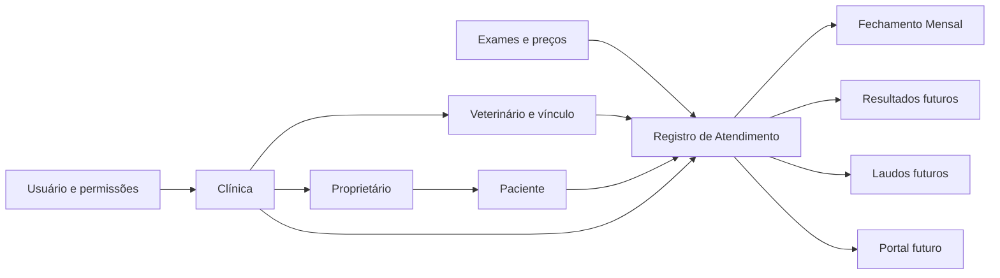

# Modelo de Domínio — Vertere Lab V2

> Este documento descreve o modelo-alvo. Na implementação atual, `Owner` está embutido em
> `Patient`, o preço vigente está em `Exam` e métodos de coleta ainda preservam códigos
> históricos. Essas diferenças deliberadas estão registradas em `docs/08-divida-tecnica.md` e
> no ADR-011; snapshots de atendimento e fechamento continuam sendo a fonte histórica.

## 1. Contextos delimitados

### Identity & Access

- `User`;
- `Credential` ou identidade externa;
- `Role`;
- `Permission`;
- `RolePermission`;
- `LabMembership`;
- `ClinicMembership`;
- `Session`;
- `AccessAudit`.

### Master Data

- `Clinic`;
- `ClinicContact`;
- `Veterinarian`;
- `VeterinarianClinic`;
- `Owner`;
- `Patient`;
- `Species`;
- `Breed`;
- `Exam`;
- `ExamPanel`;
- `ExamPanelItem`;
- `PriceTable`;
- `PriceTableItem`;
- `CollectionMethod`;
- `ServiceType`.

### Attendance

- `AttendanceRecord` — raiz do agregado operacional;
- `AttendanceExam` — item de exame;
- `AttendanceCollection` — dados da coleta;
- `AttendancePricing` — resumo financeiro;
- `AttendanceSequence` — sequência anual;
- `AttendanceRevision` — revisão auditável quando necessária.

### Billing

- `MonthlyClosure`;
- `MonthlyClosureItem`;
- `FinancialAdjustment`;
- `ClosureReopening`;
- `BillingExport`.

### Audit & Integration

- `AuditLog`;
- `OutboxEvent`;
- `IdempotencyRecord`;
- `ImportBatch`;
- `ImportRow`;
- `StoredFile`.

## 2. Grafo de dependência do núcleo

## 3. Agregado `AttendanceRecord`

### Responsabilidade

Representar o fato operacional e financeiro de que uma clínica solicitou um ou mais exames para um paciente, sob responsabilidade de um veterinário, em uma data e condição de atendimento específicas.

### Campos essenciais

- `id` opaco;
- `protocol_year`;
- `protocol_sequence`;
- `protocol_number` de negócio;
- `clinic_id`;
- `veterinarian_id`;
- `owner_id`;
- `patient_id`;
- `service_date`;
- `requested_at`;
- `status`;
- `service_level` controlado (`NORMAL` ou `ON_CALL`/plantão);
- `collection_method` controlado, usando códigos estáveis em vez dos rótulos da planilha;
- `notes` sanitizadas;
- `subtotal`;
- `discount_total`;
- `surcharge_total`;
- `grand_total`;
- `currency`;
- `billing_competence`;
- `monthly_closure_id` opcional;
- `created_by`;
- `updated_by`;
- `created_at`;
- `updated_at`;
- `row_version` para concorrência otimista.

Na implementação atual não há `owner_id`: nome e contato do tutor são dados cadastrais embutidos
no paciente. Registros novos exigem `clinic_id`; legados com `clinic_id = NULL` são visíveis
somente a atores `LAB/GLOBAL` até reconciliação auditada.

### Itens `AttendanceExam`

Cada item preserva:

- `exam_id`;
- código e nome no momento do registro;
- versão do exame;
- tabela de preço e item de origem;
- preço-base;
- desconto;
- adicional;
- total final;
- quantidade;
- justificativa de override;
- usuário que autorizou override;
- situação financeira;
- referência ao fechamento quando consolidado.

Enquanto `PriceTable` não existe, `price_base` é resolvido de `Exam` na confirmação e copiado para
o item. Alterações posteriores do catálogo nunca recalculam esse snapshot.

### Estados iniciais

`DRAFT -> CONFIRMED -> IN_PROGRESS -> COMPLETED`

Estados alternativos:

- `CANCELLED`;
- `ON_HOLD`.

Regras:

- somente `DRAFT` pode ser apagado fisicamente e apenas se não possuir dependência;
- confirmação gera protocolo;
- cancelamento exige motivo;
- atendimento incluído em fechamento não pode sofrer alteração financeira direta;
- edição de dados cadastrais que afete documento histórico deve preservar snapshot ou revisão.

## 4. Cadastros subsequentes

O formulário de atendimento pode oferecer criação rápida, mas cada cadastro é um caso de uso independente.

### Regras

- nenhuma entidade é criada por simples ausência em uma busca;
- toda criação rápida exige confirmação do usuário;
- backend executa busca de duplicidade provável antes de criar;
- cada entidade possui permissão própria;
- falha ao criar cadastro não pode deixar atendimento parcialmente confirmado;
- rascunho pode referenciar IDs já persistidos, nunca objetos temporários sem identidade;
- vínculos devem ser validados no momento da confirmação;
- inativação não remove histórico.

### Ordem de resolução

1. clínica;
2. veterinário e vínculo com clínica;
3. proprietário;
4. paciente;
5. catálogo e preço;
6. atendimento;
7. fechamento.

### Escopo clínico dos cadastros

- `Patient.clinic_id` referencia a clínica proprietária do cadastro;
- novas criações exigem `clinic_id` e o backend valida o acesso do ator;
- registros legados com `clinic_id = NULL` permanecem visíveis somente a `LAB/GLOBAL` até
  reconciliação auditada;
- paciente e atendimento devem pertencer à mesma clínica;
- listas e leituras de clínicas, veterinários e pacientes aplicam o tenant antes da paginação;
- recurso de outro tenant responde `404`, sem revelar sua existência.

## 5. Identidade e permissão

### Modelo

Permissão = `resource.action`, por exemplo:

- `users.read`;
- `users.create`;
- `users.update`;
- `roles.assign`;
- `clinics.manage`;
- `veterinarians.manage`;
- `owners.manage`;
- `patients.manage`;
- `attendances.read`;
- `attendances.create`;
- `attendances.update`;
- `attendances.cancel`;
- `attendances.override_price`;
- `closures.preview`;
- `closures.close`;
- `closures.reopen`;
- `closures.adjust`;
- `audit.read`.

Toda autorização considera:

- usuário ativo;
- sessão válida;
- permissão;
- escopo de laboratório ou clínica;
- estado da entidade;
- eventual regra de propriedade.

Papéis são agrupadores de permissões, não regras hard-coded no domínio.

`owners.read` e `owners.manage` estão reservadas e atualmente não protegem casos de uso, porque
não existe agregado `Owner` independente. Isso não concede acesso implícito aos dados de tutor;
eles seguem a autorização de `patients.*` e o tenant do paciente.

## 6. Fechamento por período

### `MonthlyClosure`

Campos essenciais:

- `id`;
- `clinic_id`;
- `competence_year`;
- `competence_month`;
- `period_start`;
- `period_end`;
- `status`;
- `item_count`;
- `subtotal`;
- `discount_total`;
- `surcharge_total`;
- `grand_total`;
- `generated_by`;
- `closed_by`;
- `generated_at`;
- `closed_at`;
- `reopened_at` opcional;
- `version`;
- `integrity_hash` opcional.

### Estados

`DRAFT -> CLOSED`

Alternativos:

- `CANCELLED` antes de fechar;
- `REOPENED` somente por fluxo excepcional;
- após correção, nova versão `CLOSED`.

### Elegibilidade

`competence_year` e `competence_month` são metadados históricos derivados de `period_start` e
mantidos por compatibilidade. Elegibilidade e unicidade usam exclusivamente o intervalo
`period_start`/`period_end`.

Um item é elegível quando:

- pertence à clínica;
- possui `service_date` dentro do período definido, inclusive nas duas extremidades;
- atendimento não está cancelado;
- item não está cancelado;
- não pertence a outro fechamento ativo;
- possui valor final válido;
- possui todos os campos financeiros obrigatórios.

### Invariantes

- períodos `CLOSED` da mesma clínica não se sobrepõem;
- fechamento fechado é imutável;
- itens do fechamento são snapshots;
- soma dos itens deve ser igual ao cabeçalho;
- cada item fonte é associado a no máximo um fechamento ativo;
- reabertura exige permissão, justificativa e auditoria;
- ajustes não alteram o valor original do atendimento;
- registro retroativo em período fechado segue política de ajuste ou reabertura, nunca inserção silenciosa.

## 7. Restrições de banco obrigatórias

- `UNIQUE(protocol_year, protocol_sequence)`;
- `EXCLUDE USING gist (clinic_id WITH =, daterange(period_start, period_end, '[]') WITH &&)`
  para fechamentos `CLOSED`;
- `CHECK(grand_total >= 0)`;
- `CHECK(discount_total >= 0)`;
- `CHECK(surcharge_total >= 0)`;
- FKs para todos os cadastros;
- `NUMERIC(14,2)` para dinheiro;
- `TIMESTAMPTZ` para timestamps;
- `DATE` para as extremidades do período;
- índices por clínica, data, status, protocolo, paciente e veterinário;
- versão de linha em edições concorrentes.

## 8. Auditoria

Ações mínimas:

- login e falha relevante;
- criação, ativação e inativação de usuário;
- alteração de papel e permissão;
- criação e atualização de cadastro mestre;
- confirmação, edição crítica e cancelamento de atendimento;
- override de preço;
- geração, fechamento, ajuste e reabertura por período;
- importação e reconciliação.

O log registra ator, escopo, ação, entidade, estado anterior reduzido, estado posterior reduzido, motivo, IP quando aplicável, request ID e timestamp. Não registra senha, token ou conteúdo sensível desnecessário.
