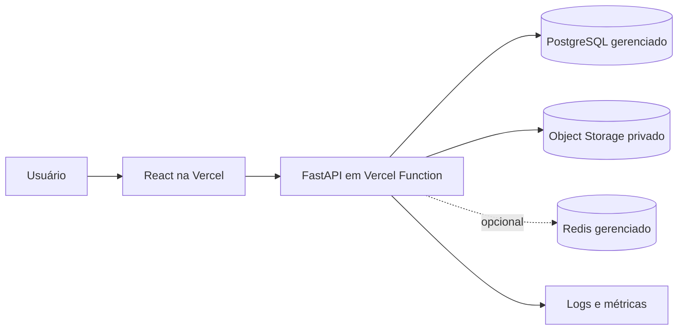

# Arquitetura de Software — Vertere Lab V2

## 1. Estilo

Monólito modular em um único repositório, com frontend e backend separados por processo e contrato HTTP. O domínio deve permanecer independente de Vercel, FastAPI, SQLAlchemy, Redis e React.

A arquitetura evita microserviços na V1, mas mantém limites claros para futura extração de notificações, laudos e integrações.

## 2. Stack

### Backend

- Python 3.12+;
- FastAPI;
- Pydantic v2;
- SQLAlchemy 2.x;
- Alembic;
- PostgreSQL;
- psycopg 3;
- pytest;
- Ruff;
- mypy.

### Frontend

- React + TypeScript;
- Vite;
- React Router;
- TanStack Query;
- React Hook Form;
- Zod para validação de interface;
- Playwright.

### Infraestrutura

- Vercel para frontend;
- FastAPI em Vercel Functions na V1 apenas para request/response curto;
- PostgreSQL gerenciado na mesma região lógica do backend;
- connection string via pooler do provedor;
- storage privado compatível com S3;
- Redis gerenciado quando justificado;
- worker Python separado quando surgirem jobs persistentes.

## 3. Topologia da V1



## 4. Limites da Vercel e regra de evolução

O FastAPI pode rodar na Vercel na V1, mas deve ser tratado como ambiente stateless:

- nada depende de memória entre requisições;
- não iniciar scheduler ou worker no startup;
- não executar loop infinito;
- não confiar em arquivo local persistente;
- upload e download grandes devem ir direto ao object storage por URL assinada;
- toda requisição precisa respeitar timeout e limite de payload;
- conexão com PostgreSQL deve usar pooler adequado ao ambiente serverless;
- tarefas duráveis usam outbox no PostgreSQL e, quando necessárias, worker externo.

### Gatilhos para retirar o backend da Vercel ou criar serviço separado

- geração frequente ou pesada de PDFs;
- filas com retries persistentes;
- envios 1:N em volume;
- processamento de arquivos;
- jobs acima do tempo seguro de requisição;
- WebSocket persistente;
- necessidade de worker 24/7;
- problemas de conexão ou cold start mensuráveis.

A saída recomendada é containerizar o mesmo backend FastAPI e executá-lo em plataforma de containers, sem alterar casos de uso ou domínio.

## 5. Estrutura do repositório

```text
backend/
  app/
    main.py
    api/
      dependencies.py
      error_handlers.py
      routers/
    core/
      config.py
      security.py
      logging.py
    shared/
      domain/
      application/
      infrastructure/
    modules/
      identity/
      clinics/
      veterinarians/
      owners/
      patients/
      catalog/
      pricing/
      attendances/
      billing/
      audit/
      imports/
      reports/
      communications/
  alembic/
  tests/
  pyproject.toml
frontend/
  src/
    app/
    features/
    entities/
    shared/
  tests/
  package.json
docs/
infra/
```

## 6. Camadas do backend

### Domain

- entidades;
- value objects;
- invariantes;
- serviços de domínio puros;
- eventos de domínio;
- interfaces mínimas quando necessárias.

Não importa FastAPI, Pydantic, SQLAlchemy, Redis ou SDK externo.

### Application

- casos de uso;
- comandos e consultas;
- unit of work;
- interfaces de repositório;
- autorização contextual;
- orquestração transacional.

### Infrastructure

- modelos SQLAlchemy;
- repositórios PostgreSQL;
- implementações de storage, Redis, e-mail e observabilidade;
- Alembic;
- adaptadores externos.

### Presentation

- routers FastAPI;
- dependências;
- schemas Pydantic;
- mapeamento de erros;
- OpenAPI.

## 7. API

- REST JSON versionada em `/api/v1`;
- OpenAPI como contrato público;
- schemas de request e response separados;
- nenhum modelo ORM retornado diretamente;
- autenticação e autorização como dependências explícitas;
- paginação por cursor ou offset limitado conforme consulta;
- filtros validados;
- `Idempotency-Key` em mutações críticas;
- `If-Match` ou `row_version` em atualizações concorrentes críticas;
- erros com código estável, mensagem segura e `request_id`.

Exemplo de envelope de erro:

```json
{
  "error": {
    "code": "ATTENDANCE_ALREADY_CLOSED",
    "message": "O atendimento não pode ser alterado porque pertence a um fechamento concluído.",
    "request_id": "...",
    "details": []
  }
}
```

## 8. Transações críticas

Usar uma única transação para:

- confirmar atendimento e gerar protocolo;
- persistir atendimento e itens;
- aplicar override financeiro autorizado;
- cancelar atendimento;
- fechar competência;
- reabrir fechamento;
- registrar ajuste;
- persistir estado e outbox.

Serviços externos nunca são chamados dentro da transação.

## 9. Sequência de protocolo

Não usar `SELECT MAX(sequence) + 1`.

Estratégia recomendada:

- tabela `attendance_sequences` por ano;
- `INSERT ... ON CONFLICT ... DO UPDATE` ou linha bloqueada com `FOR UPDATE`;
- incremento dentro da mesma transação de confirmação;
- constraint única em `(protocol_year, protocol_sequence)`;
- protocolo formatado apenas para apresentação.

## 10. Fechamento mensal

Fluxo técnico:

1. prévia fora de transação longa;
2. comando de fechamento recebe clínica, competência e idempotency key;
3. inicia transação;
4. obtém advisory lock transacional por clínica e competência;
5. valida inexistência de fechamento ativo;
6. seleciona itens elegíveis e bloqueia o conjunto necessário;
7. recalcula totais no backend;
8. cria fechamento e snapshots;
9. associa itens fonte;
10. compara soma de snapshots com cabeçalho;
11. grava auditoria e outbox;
12. commit.

Nenhuma exportação ou envio ocorre dentro dessa transação.

## 11. PostgreSQL

- fonte de verdade;
- schemas e constraints representam invariantes;
- `NUMERIC` para dinheiro;
- `TIMESTAMPTZ` para instante;
- migrations Alembic revisadas;
- índices definidos por consulta real;
- soft delete apenas quando necessário;
- isolamento de clínica aplicado em repositório e autorização;
- considerar Row-Level Security em ADR posterior, não como substituto do código.

## 12. Redis

Redis não é obrigatório para iniciar o núcleo. Só introduzir para:

- rate limit distribuído;
- cache medido;
- lock não coberto por PostgreSQL;
- fila quando houver worker externo;
- deduplicação temporária de eventos.

Nunca armazenar como fonte de verdade:

- atendimento;
- preço;
- fechamento;
- permissão;
- laudo.

## 13. Autenticação e autorização

- credenciais e sessões são responsabilidade do backend;
- senha com algoritmo forte e biblioteca consolidada;
- refresh token rotativo ou sessão opaca revogável;
- token de acesso curto;
- cookie `HttpOnly`, `Secure` e política `SameSite` compatível com os domínios;
- RBAC com permissões persistidas;
- escopo por clínica;
- deny by default;
- alteração de permissão revoga ou revalida sessão conforme risco;
- frontend apenas adapta a experiência; backend decide acesso.

## 14. Observabilidade

Logs estruturados com:

- `request_id`;
- `trace_id` quando disponível;
- `user_id`;
- `clinic_id`;
- rota;
- caso de uso;
- duração;
- status;
- código de erro.

Métricas:

- latência e erro por endpoint;
- conexões e consultas lentas;
- falhas de autorização;
- criação e cancelamento de atendimentos;
- divergência de prévia e fechamento;
- falhas de migration;
- consumo e erro de integração.

## 15. Deploy

### Frontend

- Vercel Preview por pull request;
- variáveis separadas por ambiente;
- CSP e headers de segurança;
- build TypeScript estrito;
- smoke test pós-deploy.

### Backend

- projeto Vercel separado do frontend ou roteamento claramente definido;
- entrypoint FastAPI único;
- sem estado local;
- migrations executadas por job controlado fora da inicialização da aplicação;
- health endpoint sem consulta pesada;
- rollback de aplicação separado de rollback de dados;
- região alinhada ao PostgreSQL;
- **`TRUSTED_BROWSER_ORIGINS` configurada com o(s) domínio(s) reais do frontend em produção**
  (`backend/app/core/config.py`) — o default só cobre `http://localhost:5173` (dev). Sem essa
  variável setada corretamente, o middleware de proteção CSRF por Origin
  (`backend/app/api/middleware.py`) rejeita **toda** mutação autenticada com `403
  CSRF_ORIGIN_FORBIDDEN`, inclusive login — achado em QA real durante o Incremento 4.2. Formato
  esperado: lista JSON de origens, ex. `["https://app.vertere.com.br"]`.

### Banco

- PostgreSQL gerenciado;
- pooler;
- backups automáticos;
- point-in-time recovery quando disponível;
- restore testado;
- usuário de migration separado do usuário de runtime quando possível.
