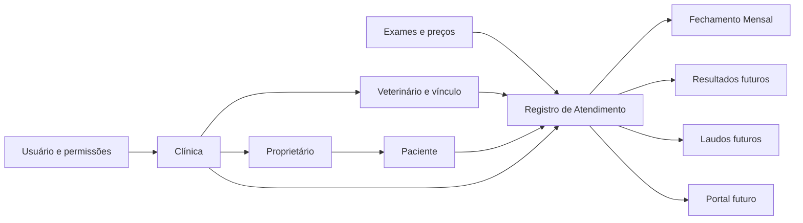
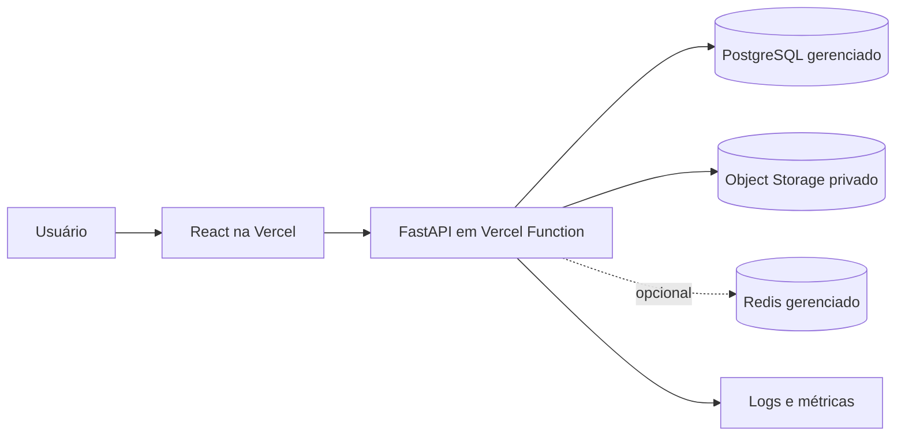

# Vertere Lab — Plano Completo V2

---
<!-- Source: README.md -->

# Vertere Lab — Planejamento V2

Este pacote revisa o planejamento do sistema Vertere Lab para a stack definida e para a prioridade real da V1.

## Stack da V1

### Backend

- Python 3.12 ou superior;
- FastAPI;
- Pydantic v2 para contratos de entrada e saída;
- SQLAlchemy 2.x para persistência;
- Alembic para migrations;
- PostgreSQL como fonte de verdade;
- pytest para testes;
- Ruff para lint e formatação;
- mypy em modo estrito nos módulos de domínio e aplicação.

### Frontend

- React com TypeScript;
- Vite como build tool recomendado;
- React Router;
- TanStack Query para estado remoto;
- React Hook Form para formulários;
- Zod apenas no frontend para validação de experiência, sem substituir a validação Pydantic do backend;
- Playwright para testes E2E.

### Infraestrutura da V1

- frontend na Vercel;
- FastAPI na Vercel somente enquanto os fluxos forem HTTP curtos e stateless;
- PostgreSQL gerenciado com connection string de pooler;
- storage de objetos privado e compatível com S3 para laudos e anexos;
- Redis gerenciado apenas quando houver caso real para cache, rate limit, lock não transacional ou fila;
- tarefas persistentes e workers não devem depender do ciclo de vida de uma Function da Vercel.

## Prioridades absolutas

1. usuários, autenticação e permissões;
2. cadastros mestres necessários ao Registro de Atendimento;
3. Registro de Atendimento como agregado central;
4. fechamento mensal reproduzível e auditável;
5. migração e reconciliação da planilha;
6. somente após a estabilidade dessas bases: laudos, portal do cliente, coletas e comunicação 1:N.

## Decisão estrutural principal

O `AttendanceRecord` — Registro de Atendimento — é a espinha dorsal do sistema. Nenhum módulo que dependa dele pode inventar, duplicar ou corrigir seus dados fora dos casos de uso oficiais. O fechamento mensal consome snapshots financeiros dos atendimentos, e não recalcula o passado a partir de cadastros atuais.

## Documentos

1. `01-analise-planilha.md` — diagnóstico da planilha atual;
2. `02-prd.md` — produto e escopo revisado;
3. `03-modelo-de-dominio.md` — entidades e invariantes;
4. `04-arquitetura.md` — arquitetura Python/FastAPI/React/PostgreSQL/Vercel;
5. `05-roadmap-backlog.md` — ordem de implementação da V1;
6. `06-estrategia-qa.md` — estratégia de qualidade baseada em risco;
7. `07-nucleo-v1.md` — especificação detalhada de usuários, permissões, atendimentos e fechamento;
8. `.claude/CLAUDE.md` — contrato central para agentes de IA;
9. `.claude/rules/*.md` — regras minuciosas por disciplina;
10. `VERTERE_LAB_PLANO_COMPLETO.md` — consolidação de todos os documentos.

---
<!-- Source: CHANGELOG-V2.md -->

# Alterações da versão 2

- backend alterado de Fastify/tRPC/Prisma para Python/FastAPI/Pydantic/SQLAlchemy/Alembic;
- frontend alterado para React + TypeScript;
- deploy da V1 orientado à Vercel com restrições serverless explícitas;
- Redis deixou de ser dependência obrigatória inicial;
- Registro de Atendimento passou a ser o agregado central;
- usuários e permissões passaram a ser a primeira entrega funcional;
- fechamento mensal foi promovido para o núcleo da V1;
- laudos, portal, coletas e comunicação foram movidos para depois do gate do núcleo;
- regras específicas de atendimento e fechamento foram adicionadas;
- testes de concorrência, idempotência, snapshots e reconciliação foram reforçados.

---
<!-- Source: 01-analise-planilha.md -->

# Análise da Planilha Operacional do Vertere Lab

## 1. Visão geral

A planilha atual funciona como cadastro mestre e livro operacional de atendimentos. Ela cumpre o papel de um sistema transacional, mas sem garantias de integridade, histórico, autorização, rastreabilidade ou colaboração simultânea segura.

### Estrutura encontrada

| Aba | Finalidade | Volume observado |
|---|---|---:|
| Cadastro Clínicas | Cadastro de clientes institucionais | 40 clínicas |
| Cadastro Veterinários | Profissionais vinculados a clínicas ou autônomos | 147 veterinários |
| Dados | Registro de protocolos, pacientes, exames e valores | 1.794 registros operacionais válidos |
| Suporte | Listas auxiliares | 5 grupos de domínio |

### Período analisado

- primeiro atendimento: 03/01/2026;
- último atendimento preenchido: 30/05/2026;
- dias com movimento: 145;
- média: aproximadamente 12,4 registros por dia ativo;
- pico observado: 29 registros em um dia.

### Volume e concentração

- 27 clínicas tiveram movimento no período;
- 86 veterinários aparecem nos atendimentos;
- aproximadamente 1.564 combinações distintas de paciente e proprietário;
- as duas clínicas de maior volume concentram cerca de 67% dos registros;
- a clínica de maior volume sozinha representa aproximadamente 52%.

Esse padrão exige que o sistema suporte picos e grande assimetria de uso entre clientes, sem permitir que uma clínica acesse dados de outra.

## 2. Problemas de qualidade e riscos operacionais

### 2.1 Cadastro sem identificadores estáveis

Clínicas, veterinários, pacientes e proprietários são referenciados por texto. Isso produz variações de caixa, acento e escrita, por exemplo nomes de clínicas equivalentes escritos de formas diferentes.

Consequências:

- duplicidade aparente;
- dificuldade de consolidação;
- vínculos frágeis;
- risco de envio de laudo ao destinatário errado;
- impossibilidade de auditoria confiável.

### 2.2 Proprietário misturado com códigos e observações

Em 885 registros o campo de proprietário contém informações entre parênteses. Em 807 registros aparece `NI` no conteúdo. Nome, possível código do cliente e ausência de informação estão no mesmo campo textual.

O novo sistema deve separar:

- proprietário/tutor;
- documento ou código externo;
- telefone;
- e-mail;
- observação;
- indicador de dado não informado.

### 2.3 Pacientes sem identidade longitudinal

O paciente é apenas um nome associado à linha do exame. Não há identificador durável, histórico consolidado, data de nascimento, espécie padronizada ou vínculo confiável com o proprietário.

Há registros sem paciente, espécie, sexo, raça, idade ou proprietário. O sistema deve permitir dados incompletos somente quando a regra clínica admitir, registrando o motivo e o usuário responsável.

### 2.4 Catálogo de exames em texto livre

Foram encontradas 180 descrições diferentes de exames. Há variações de espaço, abreviação, composição e grafia, incluindo combinações como check-ups com urinálise, perfis, pesquisas e exames adicionais.

O sistema precisa de:

- categoria de exame;
- exame individual;
- painel/perfil composto;
- itens do painel;
- material biológico exigido;
- método;
- prazo estimado;
- unidade de medida e referência quando aplicável;
- instruções pré-analíticas;
- status ativo/inativo;
- versão do exame.

### 2.5 Preço não versionado

Pelo menos 24 descrições idênticas de exame apresentam mais de um preço-base. Isso pode refletir reajuste, condição comercial, clínica específica ou erro de preenchimento.

O preço não deve ficar apenas no cadastro atual do exame. Cada item do protocolo deve armazenar um snapshot imutável de:

- preço de tabela;
- desconto;
- adicional;
- preço final;
- tabela de preço utilizada;
- vigência;
- usuário ou regra que alterou o valor.

### 2.6 Total financeiro inconsistente

A soma dos 1.794 registros operacionais válidos é R$ 185.017,00. O total exibido na planilha é R$ 185.117,00. A diferença de R$ 100,00 vem de um valor residual em uma linha sem atendimento.

O novo sistema deve impedir esse cenário por meio de:

- chaves estrangeiras;
- campos obrigatórios;
- transações;
- cálculos server-side;
- proibição de valores financeiros desacoplados de um item de protocolo;
- fechamento auditável.

### 2.7 Fórmulas frágeis

O número e o protocolo são calculados por sequência em linha. Há fórmulas residuais em linhas vazias e protocolos incompletos. A geração por `último número + 1` não é segura em uso concorrente.

O protocolo deve ser gerado no banco dentro de transação, com restrição única por ano e mecanismo resistente a concorrência.

### 2.8 Status e listas incompletos

Há veterinários sem status e valores de espécie com variação de capitalização. Campos essenciais são livres, embora exista uma aba de suporte.

Todo domínio finito deve usar enumeração controlada, tabela de domínio ou cadastro versionado. A interface nunca deve depender de digitação livre para status, espécie, sexo, método de coleta ou tipo de atendimento.

## 3. Mapeamento da planilha para o sistema

| Campo atual | Entidade futura | Tratamento |
|---|---|---|
| Clínica | `Clinic` | ID estável, CNPJ/CPF separado, status e contatos |
| Veterinário | `Veterinarian` + vínculo | CRMV normalizado e relação N:N com clínicas |
| Data/Hora | `AttendanceRecord.service_date` ou `requested_at` | timestamp com timezone |
| Nº/Protocolo | `AttendanceRecord` | sequência transacional por ano |
| Método de coleta | `CollectionMethod` | enum/cadastro controlado |
| Paciente | `Patient` | ID, espécie, raça, sexo e nascimento |
| Proprietário | `Owner` | entidade separada e deduplicável |
| Tipo de exame | `ExamCategory` | catálogo controlado |
| Exame | `Exam` ou `ExamPanel` | catálogo versionado |
| Tipo | `ServiceLevel` | normal/plantão, extensível |
| Valor/Desconto/Adicional | `AttendanceExam` | snapshot financeiro |
| Valor Total | cálculo | calculado no servidor e persistido de forma consistente |

## 4. Estratégia de migração

1. congelar uma cópia da planilha de origem;
2. importar para tabelas de staging sem transformar o conteúdo original;
3. criar uma chave `source_row_number` e um `import_batch_id`;
4. normalizar clínicas e criar mapa de aliases;
5. normalizar veterinários e CRMV;
6. separar proprietários, códigos e marcadores `NI`;
7. criar pacientes candidatos por clínica, proprietário e nome normalizado;
8. mapear exames livres para catálogo canônico;
9. criar tabela de exceções para registros ambíguos;
10. executar importação em dry-run;
11. reconciliar quantidade, valores e protocolos;
12. aprovar exceções com usuário responsável;
13. executar importação definitiva de forma idempotente;
14. manter rastreabilidade entre cada registro novo e a linha original.

## 5. Critérios de reconciliação

A migração só será aceita quando:

- 100% das linhas válidas tiverem estado final conhecido;
- a soma financeira dos registros importados corresponder à soma validada de R$ 185.017,00, salvo ajustes aprovados;
- nenhuma clínica ou veterinário for criado silenciosamente por aproximação incerta;
- todo conflito estiver em relatório de exceções;
- protocolos forem únicos;
- relatórios de duplicidade e campos ausentes forem entregues;
- o lote puder ser reprocessado sem duplicar dados.

---
<!-- Source: 02-prd.md -->

# PRD — Plataforma Vertere Lab V2

## 1. Visão

Substituir a planilha operacional do Vertere Lab por uma plataforma transacional segura, auditável e escalável. A plataforma deverá sustentar o cadastro de atendimentos, o ciclo laboratorial, o fechamento financeiro, o envio de laudos, o portal das clínicas, o histórico dos pacientes, as coletas e a comunicação 1:N.

A V1 não será considerada estável enquanto identidade, permissões, cadastros estruturantes, Registro de Atendimento e fechamento mensal não estiverem corretos.

## 2. Princípio do produto

O Registro de Atendimento é o núcleo da operação. Ele conecta:

- clínica;
- veterinário solicitante;
- proprietário/tutor;
- paciente;
- exames solicitados;
- coleta e tipo de atendimento;
- preço, desconto, adicional e total;
- competência financeira;
- resultados e laudos futuros;
- histórico e comunicação futura.

Qualquer erro nesse registro se propaga para histórico, laudo, comunicação, indicadores e fechamento. Por isso, o produto deve privilegiar integridade e rastreabilidade acima de velocidade de implementação.

## 3. Objetivos da V1

1. retirar a planilha da função de banco de dados transacional;
2. controlar quem pode acessar e modificar cada informação;
3. padronizar clínicas, veterinários, proprietários, pacientes, exames e preços;
4. registrar atendimentos sem duplicidade e com numeração segura;
5. preservar o snapshot comercial do momento do atendimento;
6. produzir fechamento mensal por clínica sem divergência;
7. manter trilha completa de alterações e exceções;
8. permitir importação reconciliada dos dados legados;
9. preparar os dados para laudos, portal e comunicação sem retrabalho estrutural.

## 4. Escopo priorizado

### P0 — núcleo obrigatório da V1

#### Identidade e acesso

- cadastro e convite de usuários;
- ativação, inativação e recuperação de acesso;
- papéis e permissões granulares;
- escopo de laboratório e escopo por clínica;
- sessões revogáveis;
- auditoria de login, bloqueio e alteração de permissão.

#### Cadastros mestres

- clínicas;
- contatos da clínica;
- veterinários;
- vínculo N:N entre veterinários e clínicas;
- proprietários/tutores;
- pacientes;
- espécies, raças e sexos controlados;
- catálogo de exames e painéis;
- tabela de preços e vigência;
- método de coleta e tipo de atendimento.

#### Registro de Atendimento

- criação em rascunho;
- busca e criação rápida dos cadastros subsequentes;
- numeração transacional;
- itens de exame;
- snapshot de preço;
- desconto e adicional com permissão e justificativa;
- cálculo server-side;
- edição controlada;
- cancelamento auditado;
- timeline;
- filtros e paginação;
- idempotência;
- bloqueio financeiro após fechamento.

#### Fechamento mensal

- prévia por clínica e competência;
- reconciliação de quantidade e valores;
- fechamento transacional;
- snapshot de itens;
- exportação básica;
- imutabilidade após fechamento;
- ajuste posterior auditável;
- reabertura excepcional mediante permissão e justificativa;
- prevenção de dois fechamentos concorrentes para a mesma clínica e período.

#### Migração e governança

- staging da planilha;
- normalização e aliases;
- relatório de exceções;
- dry-run;
- importação idempotente;
- reconciliação de contagem e valores;
- auditoria.

### P1 — depois de estabilizar o núcleo

- registro e revisão de resultados;
- laudos versionados;
- geração e armazenamento de PDF;
- portal web das clínicas;
- histórico por paciente;
- solicitação e agenda de coleta;
- notificações in-app e por e-mail;
- comunicação 1:N básica.

### P2 — evolução

- WhatsApp Business;
- aplicativo móvel;
- assinatura eletrônica;
- faturamento e cobrança;
- webhooks e integrações;
- IA assistiva;
- BI avançado;
- integrações com equipamentos.

## 5. Perspectiva dos agentes

### Agente PM

- protege o núcleo da V1 contra expansão prematura;
- mede adoção, retrabalho, divergência e tempo operacional;
- mantém riscos, dependências e rollout;
- trata migração como parte do produto.

Métricas principais:

- percentual de atendimentos criados no sistema;
- taxa de cadastros duplicados;
- taxa de correção após confirmação do atendimento;
- divergência financeira por fechamento;
- tempo médio para registrar um atendimento;
- quantidade de acessos negados corretamente;
- incidência de suporte por permissão;
- percentual de linhas migradas sem intervenção manual.

### Agente PO

- especifica cada campo, regra, estado, erro e permissão;
- não aceita história sem impacto no Registro de Atendimento e no fechamento;
- define critérios para criação rápida de cadastros;
- mantém catálogo de erros e glossário;
- prioriza fluxo vertical utilizável.

### Agente Arquiteto de Software

- mantém monólito modular;
- usa PostgreSQL como fonte de verdade;
- separa domínio, aplicação, apresentação e infraestrutura;
- impede regra de negócio no frontend;
- mantém autorização no backend;
- usa outbox para efeitos posteriores;
- evita microserviços e Redis prematuros;
- prepara saída da Vercel sem reescrever domínio.

### Agente Desenvolvedor

- implementa casos de uso pequenos e transacionais;
- separa modelos ORM, entidades, DTOs e schemas de API;
- cria migrations e testes junto da funcionalidade;
- não cria cadastros relacionados silenciosamente;
- não recalcula histórico por dados atuais;
- não permite modificação de atendimento financeiramente fechado.

### Agente QA

- testa primeiro permissões, cascatas cadastrais, concorrência e fechamento;
- exige PostgreSQL real em testes de integração;
- testa isolamento entre clínicas;
- mantém cenários de regressão da planilha;
- bloqueia release em divergência financeira ou vazamento de dados.

## 6. Personas

- Administrador do laboratório;
- Recepção/cadastro;
- Financeiro;
- Analista técnico;
- Responsável técnico;
- Administrador da clínica;
- Veterinário solicitante;
- Colaborador da clínica.

## 7. Jornada crítica: Registro de Atendimento

1. usuário autenticado entra no escopo autorizado;
2. seleciona uma clínica existente;
3. seleciona veterinário vinculado ou cria/regulariza vínculo com permissão;
4. localiza proprietário e paciente por busca normalizada;
5. quando necessário, abre criação rápida sem abandonar o atendimento;
6. seleciona exames ativos;
7. backend resolve tabela e preço vigentes;
8. usuário informa coleta, tipo de atendimento e dados clínicos mínimos;
9. backend valida permissões, duplicidade provável e consistência;
10. atendimento é salvo como rascunho ou confirmado;
11. confirmação gera número transacional, snapshots financeiros e evento de auditoria;
12. alterações posteriores obedecem estado, permissão, motivo e competência financeira.

## 8. Jornada crítica: Fechamento mensal

1. financeiro escolhe clínica e competência;
2. sistema verifica se o período está aberto;
3. sistema apresenta prévia com itens elegíveis, cancelados, pendentes e inconsistentes;
4. usuário resolve bloqueios obrigatórios;
5. backend recalcula a prévia dentro da transação de fechamento;
6. backend obtém lock lógico por clínica e competência;
7. fechamento e itens-snapshot são persistidos;
8. itens de atendimento recebem referência do fechamento;
9. totais e contagens são reconciliados antes do commit;
10. fechamento fechado torna os itens financeiros imutáveis;
11. correções futuras usam ajuste ou reabertura autorizada.

## 9. Requisitos não funcionais

### Integridade

- transações nos fluxos críticos;
- constraints no banco;
- dinheiro em `NUMERIC`, nunca float;
- idempotência em criação e fechamento;
- histórico sem sobrescrita silenciosa;
- sequência de protocolo sem `MAX + 1`.

### Segurança

- deny by default;
- RBAC com escopo;
- proteção contra IDOR/BOLA;
- cookies e tokens seguros;
- rate limit;
- logs sem dados sensíveis;
- auditoria append-only para ações críticas;
- política LGPD.

### Performance

- listas paginadas;
- busca com índices e normalização;
- p95 de leituras operacionais abaixo de 500 ms no backend em carga nominal;
- p95 de mutações comuns abaixo de 800 ms;
- fechamento de uma clínica com volume esperado dentro do limite operacional definido em teste;
- sem N+1 em telas críticas.

### Disponibilidade

- backup automático;
- restore testado;
- migrations com rollback operacional;
- health checks;
- observabilidade;
- deploy reproduzível.

## 10. Fora do escopo imediato

- microserviços;
- Kubernetes;
- event sourcing completo;
- aplicativo móvel nativo;
- IA clínica;
- faturamento bancário;
- integração com equipamentos;
- chat em tempo real;
- roteirização avançada.

## 11. Critério de sucesso do núcleo

O núcleo está pronto somente quando um atendimento completo pode ser criado, localizado, auditado, incluído em uma prévia, fechado mensalmente e reconciliado sem depender da planilha e sem permitir acesso ou alteração indevida.

---
<!-- Source: 03-modelo-de-dominio.md -->

# Modelo de Domínio — Vertere Lab V2

## 1. Contextos delimitados

### Identity & Access

- `User`;
- `Credential` ou identidade externa;
- `Role`;
- `Permission`;
- `RolePermission`;
- `LabMembership`;
- `ClinicMembership`;
- `Session`;
- `AccessAudit`.

### Master Data

- `Clinic`;
- `ClinicContact`;
- `Veterinarian`;
- `VeterinarianClinic`;
- `Owner`;
- `Patient`;
- `Species`;
- `Breed`;
- `Exam`;
- `ExamPanel`;
- `ExamPanelItem`;
- `PriceTable`;
- `PriceTableItem`;
- `CollectionMethod`;
- `ServiceType`.

### Attendance

- `AttendanceRecord` — raiz do agregado operacional;
- `AttendanceExam` — item de exame;
- `AttendanceCollection` — dados da coleta;
- `AttendancePricing` — resumo financeiro;
- `AttendanceSequence` — sequência anual;
- `AttendanceRevision` — revisão auditável quando necessária.

### Billing

- `MonthlyClosure`;
- `MonthlyClosureItem`;
- `FinancialAdjustment`;
- `ClosureReopening`;
- `BillingExport`.

### Audit & Integration

- `AuditLog`;
- `OutboxEvent`;
- `IdempotencyRecord`;
- `ImportBatch`;
- `ImportRow`;
- `StoredFile`.

## 2. Grafo de dependência do núcleo



## 3. Agregado `AttendanceRecord`

### Responsabilidade

Representar o fato operacional e financeiro de que uma clínica solicitou um ou mais exames para um paciente, sob responsabilidade de um veterinário, em uma data e condição de atendimento específicas.

### Campos essenciais

- `id` opaco;
- `protocol_year`;
- `protocol_sequence`;
- `protocol_number` de negócio;
- `clinic_id`;
- `veterinarian_id`;
- `owner_id`;
- `patient_id`;
- `service_date`;
- `requested_at`;
- `status`;
- `service_type_id`;
- `collection_method_id`;
- `notes` sanitizadas;
- `subtotal`;
- `discount_total`;
- `surcharge_total`;
- `grand_total`;
- `currency`;
- `billing_competence`;
- `monthly_closure_id` opcional;
- `created_by`;
- `updated_by`;
- `created_at`;
- `updated_at`;
- `row_version` para concorrência otimista.

### Itens `AttendanceExam`

Cada item preserva:

- `exam_id`;
- código e nome no momento do registro;
- versão do exame;
- tabela de preço e item de origem;
- preço-base;
- desconto;
- adicional;
- total final;
- quantidade;
- justificativa de override;
- usuário que autorizou override;
- situação financeira;
- referência ao fechamento quando consolidado.

### Estados iniciais

`DRAFT -> CONFIRMED -> IN_PROGRESS -> COMPLETED`

Estados alternativos:

- `CANCELLED`;
- `ON_HOLD`.

Regras:

- somente `DRAFT` pode ser apagado fisicamente e apenas se não possuir dependência;
- confirmação gera protocolo;
- cancelamento exige motivo;
- atendimento incluído em fechamento não pode sofrer alteração financeira direta;
- edição de dados cadastrais que afete documento histórico deve preservar snapshot ou revisão.

## 4. Cadastros subsequentes

O formulário de atendimento pode oferecer criação rápida, mas cada cadastro é um caso de uso independente.

### Regras

- nenhuma entidade é criada por simples ausência em uma busca;
- toda criação rápida exige confirmação do usuário;
- backend executa busca de duplicidade provável antes de criar;
- cada entidade possui permissão própria;
- falha ao criar cadastro não pode deixar atendimento parcialmente confirmado;
- rascunho pode referenciar IDs já persistidos, nunca objetos temporários sem identidade;
- vínculos devem ser validados no momento da confirmação;
- inativação não remove histórico.

### Ordem de resolução

1. clínica;
2. veterinário e vínculo com clínica;
3. proprietário;
4. paciente;
5. catálogo e preço;
6. atendimento;
7. fechamento.

## 5. Identidade e permissão

### Modelo

Permissão = `resource.action`, por exemplo:

- `users.read`;
- `users.create`;
- `users.update`;
- `roles.assign`;
- `clinics.manage`;
- `veterinarians.manage`;
- `owners.manage`;
- `patients.manage`;
- `attendances.read`;
- `attendances.create`;
- `attendances.update`;
- `attendances.cancel`;
- `attendances.override_price`;
- `closures.preview`;
- `closures.close`;
- `closures.reopen`;
- `closures.adjust`;
- `audit.read`.

Toda autorização considera:

- usuário ativo;
- sessão válida;
- permissão;
- escopo de laboratório ou clínica;
- estado da entidade;
- eventual regra de propriedade.

Papéis são agrupadores de permissões, não regras hard-coded no domínio.

## 6. Fechamento mensal

### `MonthlyClosure`

Campos essenciais:

- `id`;
- `clinic_id`;
- `competence_year`;
- `competence_month`;
- `period_start`;
- `period_end`;
- `status`;
- `item_count`;
- `subtotal`;
- `discount_total`;
- `surcharge_total`;
- `grand_total`;
- `generated_by`;
- `closed_by`;
- `generated_at`;
- `closed_at`;
- `reopened_at` opcional;
- `version`;
- `integrity_hash` opcional.

### Estados

`DRAFT -> CLOSED`

Alternativos:

- `CANCELLED` antes de fechar;
- `REOPENED` somente por fluxo excepcional;
- após correção, nova versão `CLOSED`.

### Elegibilidade

Um item é elegível quando:

- pertence à clínica;
- está dentro da competência definida;
- atendimento não está cancelado;
- item não está cancelado;
- não pertence a outro fechamento ativo;
- possui valor final válido;
- possui todos os campos financeiros obrigatórios.

### Invariantes

- unicidade ativa por clínica e competência;
- fechamento fechado é imutável;
- itens do fechamento são snapshots;
- soma dos itens deve ser igual ao cabeçalho;
- cada item fonte é associado a no máximo um fechamento ativo;
- reabertura exige permissão, justificativa e auditoria;
- ajustes não alteram o valor original do atendimento;
- registro retroativo em período fechado segue política de ajuste ou reabertura, nunca inserção silenciosa.

## 7. Restrições de banco obrigatórias

- `UNIQUE(protocol_year, protocol_sequence)`;
- `UNIQUE(clinic_id, competence_year, competence_month)` para fechamento ativo, implementada conforme estratégia de status;
- `CHECK(grand_total >= 0)`;
- `CHECK(discount_total >= 0)`;
- `CHECK(surcharge_total >= 0)`;
- FKs para todos os cadastros;
- `NUMERIC(14,2)` para dinheiro;
- `TIMESTAMPTZ` para timestamps;
- `DATE` ou ano/mês explícito para competência;
- índices por clínica, data, status, protocolo, paciente e veterinário;
- versão de linha em edições concorrentes.

## 8. Auditoria

Ações mínimas:

- login e falha relevante;
- criação, ativação e inativação de usuário;
- alteração de papel e permissão;
- criação e atualização de cadastro mestre;
- confirmação, edição crítica e cancelamento de atendimento;
- override de preço;
- geração, fechamento, ajuste e reabertura mensal;
- importação e reconciliação.

O log registra ator, escopo, ação, entidade, estado anterior reduzido, estado posterior reduzido, motivo, IP quando aplicável, request ID e timestamp. Não registra senha, token ou conteúdo sensível desnecessário.

---
<!-- Source: 04-arquitetura.md -->

# Arquitetura de Software — Vertere Lab V2

## 1. Estilo

Monólito modular em um único repositório, com frontend e backend separados por processo e contrato HTTP. O domínio deve permanecer independente de Vercel, FastAPI, SQLAlchemy, Redis e React.

A arquitetura evita microserviços na V1, mas mantém limites claros para futura extração de notificações, laudos e integrações.

## 2. Stack

### Backend

- Python 3.12+;
- FastAPI;
- Pydantic v2;
- SQLAlchemy 2.x;
- Alembic;
- PostgreSQL;
- psycopg 3;
- pytest;
- Ruff;
- mypy.

### Frontend

- React + TypeScript;
- Vite;
- React Router;
- TanStack Query;
- React Hook Form;
- Zod para validação de interface;
- Playwright.

### Infraestrutura

- Vercel para frontend;
- FastAPI em Vercel Functions na V1 apenas para request/response curto;
- PostgreSQL gerenciado na mesma região lógica do backend;
- connection string via pooler do provedor;
- storage privado compatível com S3;
- Redis gerenciado quando justificado;
- worker Python separado quando surgirem jobs persistentes.

## 3. Topologia da V1



## 4. Limites da Vercel e regra de evolução

O FastAPI pode rodar na Vercel na V1, mas deve ser tratado como ambiente stateless:

- nada depende de memória entre requisições;
- não iniciar scheduler ou worker no startup;
- não executar loop infinito;
- não confiar em arquivo local persistente;
- upload e download grandes devem ir direto ao object storage por URL assinada;
- toda requisição precisa respeitar timeout e limite de payload;
- conexão com PostgreSQL deve usar pooler adequado ao ambiente serverless;
- tarefas duráveis usam outbox no PostgreSQL e, quando necessárias, worker externo.

### Gatilhos para retirar o backend da Vercel ou criar serviço separado

- geração frequente ou pesada de PDFs;
- filas com retries persistentes;
- envios 1:N em volume;
- processamento de arquivos;
- jobs acima do tempo seguro de requisição;
- WebSocket persistente;
- necessidade de worker 24/7;
- problemas de conexão ou cold start mensuráveis.

A saída recomendada é containerizar o mesmo backend FastAPI e executá-lo em plataforma de containers, sem alterar casos de uso ou domínio.

## 5. Estrutura do repositório

```text
backend/
  app/
    main.py
    api/
      dependencies.py
      error_handlers.py
      routers/
    core/
      config.py
      security.py
      logging.py
    shared/
      domain/
      application/
      infrastructure/
    modules/
      identity/
      clinics/
      veterinarians/
      owners/
      patients/
      catalog/
      pricing/
      attendances/
      billing/
      audit/
      imports/
      reports/
      communications/
  alembic/
  tests/
  pyproject.toml
frontend/
  src/
    app/
    features/
    entities/
    shared/
  tests/
  package.json
docs/
infra/
```

## 6. Camadas do backend

### Domain

- entidades;
- value objects;
- invariantes;
- serviços de domínio puros;
- eventos de domínio;
- interfaces mínimas quando necessárias.

Não importa FastAPI, Pydantic, SQLAlchemy, Redis ou SDK externo.

### Application

- casos de uso;
- comandos e consultas;
- unit of work;
- interfaces de repositório;
- autorização contextual;
- orquestração transacional.

### Infrastructure

- modelos SQLAlchemy;
- repositórios PostgreSQL;
- implementações de storage, Redis, e-mail e observabilidade;
- Alembic;
- adaptadores externos.

### Presentation

- routers FastAPI;
- dependências;
- schemas Pydantic;
- mapeamento de erros;
- OpenAPI.

## 7. API

- REST JSON versionada em `/api/v1`;
- OpenAPI como contrato público;
- schemas de request e response separados;
- nenhum modelo ORM retornado diretamente;
- autenticação e autorização como dependências explícitas;
- paginação por cursor ou offset limitado conforme consulta;
- filtros validados;
- `Idempotency-Key` em mutações críticas;
- `If-Match` ou `row_version` em atualizações concorrentes críticas;
- erros com código estável, mensagem segura e `request_id`.

Exemplo de envelope de erro:

```json
{
  "error": {
    "code": "ATTENDANCE_ALREADY_CLOSED",
    "message": "O atendimento não pode ser alterado porque pertence a um fechamento concluído.",
    "request_id": "...",
    "details": []
  }
}
```

## 8. Transações críticas

Usar uma única transação para:

- confirmar atendimento e gerar protocolo;
- persistir atendimento e itens;
- aplicar override financeiro autorizado;
- cancelar atendimento;
- fechar competência;
- reabrir fechamento;
- registrar ajuste;
- persistir estado e outbox.

Serviços externos nunca são chamados dentro da transação.

## 9. Sequência de protocolo

Não usar `SELECT MAX(sequence) + 1`.

Estratégia recomendada:

- tabela `attendance_sequences` por ano;
- `INSERT ... ON CONFLICT ... DO UPDATE` ou linha bloqueada com `FOR UPDATE`;
- incremento dentro da mesma transação de confirmação;
- constraint única em `(protocol_year, protocol_sequence)`;
- protocolo formatado apenas para apresentação.

## 10. Fechamento mensal

Fluxo técnico:

1. prévia fora de transação longa;
2. comando de fechamento recebe clínica, competência e idempotency key;
3. inicia transação;
4. obtém advisory lock transacional por clínica e competência;
5. valida inexistência de fechamento ativo;
6. seleciona itens elegíveis e bloqueia o conjunto necessário;
7. recalcula totais no backend;
8. cria fechamento e snapshots;
9. associa itens fonte;
10. compara soma de snapshots com cabeçalho;
11. grava auditoria e outbox;
12. commit.

Nenhuma exportação ou envio ocorre dentro dessa transação.

## 11. PostgreSQL

- fonte de verdade;
- schemas e constraints representam invariantes;
- `NUMERIC` para dinheiro;
- `TIMESTAMPTZ` para instante;
- migrations Alembic revisadas;
- índices definidos por consulta real;
- soft delete apenas quando necessário;
- isolamento de clínica aplicado em repositório e autorização;
- considerar Row-Level Security em ADR posterior, não como substituto do código.

## 12. Redis

Redis não é obrigatório para iniciar o núcleo. Só introduzir para:

- rate limit distribuído;
- cache medido;
- lock não coberto por PostgreSQL;
- fila quando houver worker externo;
- deduplicação temporária de eventos.

Nunca armazenar como fonte de verdade:

- atendimento;
- preço;
- fechamento;
- permissão;
- laudo.

## 13. Autenticação e autorização

- credenciais e sessões são responsabilidade do backend;
- senha com algoritmo forte e biblioteca consolidada;
- refresh token rotativo ou sessão opaca revogável;
- token de acesso curto;
- cookie `HttpOnly`, `Secure` e política `SameSite` compatível com os domínios;
- RBAC com permissões persistidas;
- escopo por clínica;
- deny by default;
- alteração de permissão revoga ou revalida sessão conforme risco;
- frontend apenas adapta a experiência; backend decide acesso.

## 14. Observabilidade

Logs estruturados com:

- `request_id`;
- `trace_id` quando disponível;
- `user_id`;
- `clinic_id`;
- rota;
- caso de uso;
- duração;
- status;
- código de erro.

Métricas:

- latência e erro por endpoint;
- conexões e consultas lentas;
- falhas de autorização;
- criação e cancelamento de atendimentos;
- divergência de prévia e fechamento;
- falhas de migration;
- consumo e erro de integração.

## 15. Deploy

### Frontend

- Vercel Preview por pull request;
- variáveis separadas por ambiente;
- CSP e headers de segurança;
- build TypeScript estrito;
- smoke test pós-deploy.

### Backend

- projeto Vercel separado do frontend ou roteamento claramente definido;
- entrypoint FastAPI único;
- sem estado local;
- migrations executadas por job controlado fora da inicialização da aplicação;
- health endpoint sem consulta pesada;
- rollback de aplicação separado de rollback de dados;
- região alinhada ao PostgreSQL.

### Banco

- PostgreSQL gerenciado;
- pooler;
- backups automáticos;
- point-in-time recovery quando disponível;
- restore testado;
- usuário de migration separado do usuário de runtime quando possível.

---
<!-- Source: 05-roadmap-backlog.md -->

# Roadmap e Backlog — Vertere Lab V2

## 1. Regra de priorização

Nenhum módulo dependente de atendimento deve avançar com dados falsos, tabelas provisórias ou atalhos que violem o modelo definitivo. O projeto será entregue por fatias verticais.

## 2. Fase 0 — Descoberta e decisões

Entregáveis:

- glossário aprovado;
- campos obrigatórios do Registro de Atendimento;
- matriz de permissão;
- política de duplicidade;
- política de alteração e cancelamento;
- regra de competência financeira;
- regra de atraso e retroatividade;
- política de reabertura;
- catálogo inicial de exames;
- aliases da planilha;
- ADRs de autenticação, protocolo, tenant e fechamento.

Gate:

- PO e operação conseguem executar em protótipo o cadastro de um atendimento e a conferência de um fechamento.

## 3. Fase 1 — Fundação técnica e identidade

Épicos:

- estrutura backend/frontend;
- configuração por ambiente;
- FastAPI, SQLAlchemy, Alembic e PostgreSQL;
- React e design system mínimo;
- autenticação;
- usuários;
- papéis e permissões;
- memberships por clínica;
- auditoria;
- tratamento de erros;
- CI/CD;
- observabilidade básica.

Gate:

- usuário ativo entra;
- usuário inativo não entra;
- alteração de papel é auditada;
- clínica A não acessa clínica B;
- permissões são testadas no backend.

## 4. Fase 2 — Cadastros estruturantes

Ordem:

1. clínicas e contatos;
2. veterinários;
3. vínculo veterinário-clínica;
4. proprietários;
5. pacientes;
6. espécies e raças;
7. catálogo de exames e painéis;
8. tabelas de preço e vigência;
9. métodos de coleta e tipos de atendimento.

Para cada cadastro:

- criar;
- editar;
- inativar;
- consultar;
- buscar;
- detectar duplicidade provável;
- auditar;
- testar permissão;
- preservar histórico.

Gate:

- dados necessários a um atendimento completo existem e não dependem de texto livre indevido.

## 5. Fase 3 — Registro de Atendimento

### Incremento 3.1 — Rascunho

- formulário principal;
- seleção de clínica;
- seleção de veterinário;
- seleção/criação rápida de proprietário e paciente;
- seleção de exames;
- persistência de rascunho;
- validação progressiva.

### Incremento 3.2 — Confirmação

- validação completa;
- idempotency key;
- sequência transacional;
- snapshots de exame e preço;
- cálculo server-side;
- auditoria;
- timeline.

### Incremento 3.3 — Manutenção

- busca e filtros;
- edição com versão;
- cancelamento com motivo;
- override de preço;
- bloqueio por estado;
- exportação simples de conferência.

Gate:

- fluxos concorrentes não duplicam protocolo;
- duplo clique não duplica atendimento;
- atualização de preço não altera atendimento existente;
- permissão e tenant estão cobertos;
- valores reconciliam com casos de teste.

## 6. Fase 4 — Fechamento mensal

### Incremento 4.1 — Prévia

- filtro por clínica e competência;
- itens elegíveis;
- itens bloqueados e motivos;
- contagens;
- subtotal, descontos, adicionais e total;
- drill-down para atendimento.

### Incremento 4.2 — Fechamento

- lock por clínica e competência;
- idempotência;
- snapshot;
- associação dos itens;
- imutabilidade;
- auditoria;
- exportação CSV/PDF simples, fora da transação.

### Incremento 4.3 — Exceções

- ajuste posterior;
- reabertura excepcional;
- atendimento retroativo;
- cancelamento posterior;
- histórico de versões.

Gate:

- mesma competência não fecha duas vezes;
- totais do cabeçalho e itens são idênticos;
- atendimento fechado não é alterado diretamente;
- reabertura e ajuste são auditados;
- fechamento é reproduzível.

## 7. Fase 5 — Migração e piloto

- staging da planilha;
- normalização;
- aliases;
- dry-run;
- relatório de exceções;
- importação idempotente;
- reconciliação dos 1.794 registros válidos e do valor validado;
- piloto com usuários internos;
- operação paralela curta;
- corte da planilha.

## 8. Fase 6 — Resultados e laudos

- resultados estruturados;
- revisão técnica;
- laudo versionado;
- PDF;
- storage privado;
- publicação e download auditados.

## 9. Fase 7 — Portal, coletas e comunicação

- portal das clínicas;
- histórico do paciente;
- agenda e solicitação de coleta;
- notificações;
- comunicados 1:N;
- respostas e anexos.

## 10. Definition of Ready

Uma história está pronta quando informa:

- problema e resultado;
- ator;
- permissão;
- escopo;
- dados obrigatórios;
- duplicidade;
- estado anterior e posterior;
- regra financeira;
- impacto no atendimento;
- impacto no fechamento;
- auditoria;
- erros;
- critérios de aceite;
- testes;
- estratégia de migração quando aplicável.

## 11. Definition of Done

- implementação completa;
- Ruff passa;
- mypy passa no escopo definido;
- TypeScript passa;
- testes unitários e de integração passam;
- E2E crítico passa;
- migration revisada e aplicada em ambiente de teste;
- autorização backend testada;
- auditoria verificada;
- logs e métricas adequados;
- documentação atualizada;
- nenhum segredo ou PII indevida;
- rollback considerado;
- critérios de aceite demonstrados.

## 12. Ordem proibida

Não iniciar como prioridade antes do gate do fechamento:

- IA;
- WhatsApp;
- aplicativo móvel;
- dashboards sofisticados;
- microserviços;
- BI avançado;
- integração com equipamentos;
- automações que dependam de atendimento ainda instável.

---
<!-- Source: 06-estrategia-qa.md -->

# Estratégia de QA — Vertere Lab V2

## 1. Estratégia baseada em risco

Risco máximo:

1. acesso indevido;
2. cadastro mestre incorreto ou duplicado;
3. atendimento inconsistente;
4. preço ou total incorreto;
5. fechamento divergente;
6. alteração de histórico fechado;
7. migração incompleta.

Esses riscos bloqueiam release.

## 2. Ferramentas recomendadas

### Backend

- pytest;
- pytest-asyncio quando aplicável;
- Testcontainers ou PostgreSQL real isolado;
- factory_boy ou factories próprias;
- Hypothesis para propriedades financeiras e invariantes;
- coverage.py;
- HTTPX/ASGITransport para API.

### Frontend

- Vitest;
- Testing Library;
- MSW para simulação de contrato no teste de UI;
- Playwright para E2E.

### Qualidade estática

- Ruff;
- mypy;
- TypeScript strict;
- auditoria de dependências;
- secret scanning.

## 3. Pirâmide de testes

### Unitários

- regras de permissão;
- normalização;
- detecção de duplicidade;
- cálculo de preço;
- arredondamento;
- estados do atendimento;
- elegibilidade do fechamento;
- cálculo de fechamento;
- regras de ajuste e reabertura.

### Integração

- repositórios com PostgreSQL real;
- constraints;
- transações;
- sequência concorrente;
- idempotência;
- Alembic upgrade/downgrade quando suportado;
- autorização com dados reais;
- fechamento concorrente;
- outbox.

### API/contrato

- OpenAPI;
- request e response;
- códigos de erro;
- paginação;
- filtros;
- idempotency key;
- versionamento de concorrência;
- CORS e autenticação.

### E2E

1. admin cria usuário e atribui permissão;
2. recepção cria clínica/veterinário/proprietário/paciente;
3. recepção registra e confirma atendimento;
4. financeiro abre prévia;
5. financeiro fecha competência;
6. recepção tenta alterar valor e recebe bloqueio;
7. financeiro registra ajuste autorizado;
8. usuário de outra clínica tenta acessar e recebe negação.

## 4. Matriz de permissão

Para cada endpoint e ação:

- sem sessão;
- sessão expirada;
- usuário inativo;
- papel sem permissão;
- permissão correta em clínica errada;
- permissão correta no escopo correto;
- administrador do laboratório;
- alteração de papel durante sessão.

A UI não é evidência de segurança. O teste deve chamar a API diretamente.

## 5. Testes do Registro de Atendimento

### Validação

- clínica inexistente ou inativa;
- veterinário inexistente, inativo ou sem vínculo;
- paciente de outro proprietário;
- paciente de outra clínica quando a regra proíbe;
- exame inativo;
- preço sem vigência;
- lista vazia de exames;
- desconto acima da política;
- adicional negativo;
- datas inválidas;
- campos mínimos ausentes.

### Concorrência

- 50 confirmações simultâneas geram 50 protocolos únicos;
- duas atualizações com mesma versão produzem um conflito;
- duplo submit com mesma idempotency key gera um atendimento;
- mesma key com payload diferente gera conflito;
- cancelamento e fechamento simultâneos não corrompem dados.

### Snapshot

- mudar nome de exame não muda atendimento antigo;
- reajustar preço não muda atendimento antigo;
- inativar veterinário não remove histórico;
- merge de paciente mantém referência.

## 6. Testes de fechamento

- período vazio;
- competência já fechada;
- dois fechamentos simultâneos;
- atendimento cancelado;
- item cancelado;
- preço zero permitido ou proibido conforme regra;
- valor residual sem atendimento impossível por FK;
- soma de itens igual ao cabeçalho;
- arredondamento em múltiplos itens;
- desconto e adicional;
- item já associado a fechamento;
- atendimento retroativo;
- reabertura sem permissão;
- ajuste sem motivo;
- exportação compatível com snapshot;
- reprocessamento idempotente.

## 7. Propriedades financeiras

Usar testes baseados em propriedades para garantir:

- `grand_total = subtotal - discount_total + surcharge_total`;
- total nunca é NaN ou float;
- soma do fechamento é soma exata dos snapshots;
- ajuste não altera snapshot original;
- duas execuções idempotentes retornam o mesmo fechamento;
- nenhuma combinação válida gera valor negativo não permitido.

## 8. Testes de migração

- todas as linhas recebem status final;
- importação repetida não duplica;
- aliases resolvem de forma determinística;
- conflito não é resolvido por aproximação silenciosa;
- soma validada é reconciliada;
- valor residual sem atendimento é reportado, não importado;
- IDs de origem são preservados;
- dry-run não altera produção.

## 9. Performance

Cenários:

- login;
- busca de clínica;
- busca de proprietário e paciente;
- formulário com catálogo;
- confirmação concorrente;
- listagem paginada;
- prévia de fechamento;
- fechamento com volume superior ao atual;
- exportação.

Gates iniciais:

- erro inferior a 1% em carga nominal;
- p95 conforme PRD;
- ausência de N+1 crítico;
- locks curtos;
- conexões de banco estáveis no ambiente serverless;
- consulta crítica com plano conhecido.

## 10. Segurança

- IDOR/BOLA;
- escalação horizontal e vertical;
- brute force;
- enumeração de usuário;
- CSRF conforme autenticação;
- XSS;
- SQL injection;
- mass assignment;
- excesso de campos em response;
- logs com PII;
- token no localStorage quando proibido;
- sessão após inativação;
- upload e URL assinada em módulos futuros.

## 11. Dados de teste

- nunca usar cópia bruta de produção em CI;
- gerar ao menos duas clínicas;
- usuários com permissões distintas;
- nomes com acentos;
- dados incompletos permitidos;
- duplicidades prováveis;
- relógio controlado;
- valores monetários extremos e centavos;
- competência aberta e fechada.

## 12. Gates de release

Bloqueia release:

- vazamento entre clínicas;
- protocolo duplicado;
- divergência financeira;
- alteração de atendimento fechado;
- migration irreversível sem plano;
- vulnerabilidade crítica/alta;
- E2E crítico falhando;
- teste flaky ignorado;
- auditoria ausente em ação crítica.

---
<!-- Source: 07-nucleo-v1.md -->

# Especificação do Núcleo da V1

## 1. Objetivo

Definir com precisão os três pilares que devem ser concluídos antes dos módulos de laudos, portal, coleta e comunicação:

1. usuários e permissões;
2. Registro de Atendimento e cadastros subsequentes;
3. fechamento mensal.

## 2. Usuários e permissões

### 2.1 Papéis iniciais sugeridos

| Papel | Escopo | Finalidade |
|---|---|---|
| `SUPER_ADMIN` | global | manutenção excepcional da plataforma |
| `LAB_ADMIN` | laboratório | usuários, permissões e configurações |
| `RECEPTION` | laboratório | cadastros e atendimentos |
| `FINANCE` | laboratório | preços, prévias, fechamentos e ajustes |
| `TECHNICAL` | laboratório | operação técnica futura |
| `TECHNICAL_MANAGER` | laboratório | revisão e laudos futuros |
| `CLINIC_ADMIN` | clínica | usuários e visão da própria clínica |
| `VETERINARIAN` | clínica | solicitações e laudos próprios/permitidos |
| `CLINIC_STAFF` | clínica | consulta limitada |

A aplicação verifica permissões, não nomes de papéis.

### 2.2 Permissões mínimas

```text
users.read
users.create
users.update
users.deactivate
roles.read
roles.assign
permissions.read
clinics.read
clinics.manage
veterinarians.read
veterinarians.manage
owners.read
owners.manage
patients.read
patients.manage
catalog.read
catalog.manage
pricing.read
pricing.manage
attendances.read
attendances.create
attendances.update
attendances.cancel
attendances.override_price
closures.read
closures.preview
closures.close
closures.adjust
closures.reopen
audit.read
imports.execute
```

### 2.3 Regras

- deny by default;
- usuário inativo não autentica nem renova sessão;
- permissão é avaliada no backend;
- acesso de clínica exige membership ativo;
- usuário de clínica nunca escolhe `clinic_id` fora das memberships;
- usuário interno com escopo global precisa de permissão explícita;
- alteração de papel é auditada;
- privilégios críticos podem exigir reautenticação;
- nenhum endpoint sensível depende apenas de ocultar botão.

## 3. Registro de Atendimento

### 3.1 Tela principal

Seções recomendadas:

1. identificação do atendimento;
2. clínica e veterinário;
3. proprietário e paciente;
4. exames;
5. coleta e atendimento;
6. valores;
7. observações;
8. resumo e confirmação.

### 3.2 Criação rápida

Cada seletor de cadastro oferece:

- busca normalizada;
- resultados prováveis;
- aviso de possível duplicidade;
- botão de criação somente com permissão;
- modal ou drawer sem perder o rascunho;
- retorno do novo ID após sucesso;
- tratamento de conflito se outro usuário criou o mesmo registro.

### 3.3 Confirmação atômica

A confirmação deve:

1. revalidar todos os IDs;
2. verificar status e vínculo;
3. resolver preço vigente no servidor;
4. validar overrides;
5. calcular totais;
6. obter próximo protocolo;
7. persistir cabeçalho e itens;
8. persistir auditoria e outbox;
9. commit;
10. retornar representação completa.

Nenhum atendimento confirmado pode existir sem ao menos um item.

### 3.4 Regras de edição

- rascunho: edição ampla conforme permissão;
- confirmado e ainda aberto financeiramente: edição controlada;
- campos críticos exigem auditoria;
- mudança de preço exige `attendances.override_price` e motivo;
- cancelamento exige motivo;
- fechado: sem alteração financeira direta;
- conflito de versão retorna HTTP 409;
- alteração não deve apagar o valor anterior do audit log.

### 3.5 Endpoints iniciais

```text
POST   /api/v1/attendances/drafts
GET    /api/v1/attendances
GET    /api/v1/attendances/{id}
PATCH  /api/v1/attendances/{id}
POST   /api/v1/attendances/{id}/confirm
POST   /api/v1/attendances/{id}/cancel
GET    /api/v1/attendances/{id}/timeline
```

Cadastros possuem endpoints próprios. Não criar proprietário/paciente implicitamente dentro de `/confirm`.

## 4. Fechamento mensal

### 4.1 Conceito de competência

A competência deve ser definida explicitamente por regra aprovada. Recomendação inicial: usar `service_date` do atendimento, armazenando `billing_competence` no momento da confirmação. Mudanças retroativas seguem política formal.

### 4.2 Prévia

A prévia exibe:

- clínica;
- competência;
- quantidade de atendimentos;
- quantidade de itens;
- subtotal;
- descontos;
- adicionais;
- total;
- atendimentos cancelados;
- itens bloqueados;
- motivos de inconsistência;
- diferença em relação a uma prévia anterior.

A prévia não bloqueia itens e não é documento final.

### 4.3 Fechar

Pré-condições:

- permissão `closures.close`;
- clínica ativa ou elegível;
- competência válida;
- nenhuma inconsistência bloqueante;
- nenhuma outra closure ativa;
- idempotency key;
- justificativa quando a política exigir.

Pós-condições:

- fechamento `CLOSED`;
- snapshots persistidos;
- itens associados;
- totais reconciliados;
- auditoria;
- evento de outbox;
- itens financeiros protegidos.

### 4.4 Ajuste

Um ajuste:

- referencia o fechamento e, quando possível, o item original;
- possui tipo crédito ou débito;
- possui valor, motivo, autor e data;
- não modifica snapshot original;
- aparece em exportações e versões posteriores.

### 4.5 Reabertura

Reabertura é excepcional:

- permissão específica;
- reautenticação quando adotada;
- justificativa obrigatória;
- auditoria;
- bloqueio concorrente;
- preservação da versão anterior;
- nova versão ao fechar novamente.

### 4.6 Endpoints iniciais

```text
GET  /api/v1/closures/preview?clinic_id=&year=&month=
POST /api/v1/closures
GET  /api/v1/closures
GET  /api/v1/closures/{id}
POST /api/v1/closures/{id}/adjustments
POST /api/v1/closures/{id}/reopen
GET  /api/v1/closures/{id}/export
```

## 5. Critérios de aceite do núcleo

- nenhuma permissão é decidida somente no frontend;
- clínica A não lê nem altera dados da B;
- protocolo é único sob concorrência;
- atendimento duplicado por retry não ocorre;
- preços históricos permanecem estáveis;
- fechamento duplica zero itens;
- total do fechamento é exato;
- atendimento fechado rejeita alteração financeira;
- ajuste e reabertura são rastreáveis;
- migração reconcilia contagem e valores;
- todos os fluxos críticos têm testes E2E.

---
<!-- Source: .claude/CLAUDE.md -->

# CLAUDE.md — Contrato Central do Vertere Lab V2

## 1. Missão

Construir o Vertere Lab com integridade transacional, segurança, rastreabilidade, desempenho e clareza de domínio. O Registro de Atendimento e o fechamento mensal são o núcleo do produto.

## 2. Ordem de leitura obrigatória

1. este arquivo;
2. `.claude/rules/00-global.md`;
3. `.claude/rules/01-product-domain.md`;
4. `.claude/rules/12-attendance.md` quando a tarefa tocar cadastros ou atendimento;
5. `.claude/rules/13-monthly-closure.md` quando tocar financeiro;
6. regra técnica correspondente;
7. PRD, modelo de domínio e ADRs afetados.

## 3. Stack obrigatória

### Backend

- Python 3.12+;
- FastAPI;
- Pydantic v2;
- SQLAlchemy 2.x;
- Alembic;
- PostgreSQL;
- pytest;
- Ruff;
- mypy.

### Frontend

- React + TypeScript;
- Vite;
- TanStack Query;
- React Hook Form;
- Playwright.

### Infra

- Vercel na V1 para frontend e, enquanto adequado, FastAPI stateless;
- PostgreSQL gerenciado;
- Redis somente com justificativa;
- storage privado compatível com S3.

Não substituir componentes estruturais sem ADR e aprovação.

## 4. Prioridade de implementação

1. autenticação, usuários, papéis e permissões;
2. cadastros estruturantes;
3. Registro de Atendimento;
4. fechamento mensal;
5. migração;
6. resultados, laudos, portal, coletas e comunicação.

É proibido priorizar módulo secundário criando atalhos que comprometam essa ordem.

## 5. Decisões não negociáveis

- PostgreSQL é fonte de verdade;
- autorização acontece no backend;
- permissão considera escopo;
- papéis agrupam permissões; código não depende de nome de papel;
- `AttendanceRecord` é raiz do fluxo operacional;
- dinheiro usa Decimal/NUMERIC;
- preço do atendimento é snapshot;
- fechamento fechado é imutável;
- alteração posterior usa ajuste ou reabertura auditada;
- protocolo é gerado transacionalmente;
- criação e fechamento são idempotentes;
- serviços externos não participam da transação de negócio;
- audit log em ações críticas;
- Vercel é stateless;
- Redis não substitui PostgreSQL;
- segredo e PII não aparecem em código ou log.

## 6. Checklist antes de alterar código

A IA deve identificar:

1. problema;
2. ator;
3. permissão;
4. escopo;
5. agregado afetado;
6. invariantes;
7. estado anterior e posterior;
8. impacto financeiro;
9. impacto no fechamento;
10. transação;
11. concorrência;
12. idempotência;
13. migration;
14. API;
15. auditoria;
16. testes;
17. observabilidade;
18. rollback.

## 7. Proibições

- regra de negócio em router ou componente React;
- modelo SQLAlchemy como response da API;
- `Session` de banco global;
- commit em repository isolado sem unit of work;
- `float` para dinheiro;
- `MAX + 1` para protocolo;
- `clinic_id` confiado do body sem autorização;
- cadastro relacionado criado silenciosamente;
- alteração de item fechado;
- recalcular histórico por catálogo atual;
- capturar exceção e ignorar;
- usar `dict[str, Any]` como contrato sem necessidade;
- migration destrutiva em uma etapa;
- Redis sem TTL para cache;
- worker persistente dentro da Vercel Function;
- arquivo local como armazenamento durável;
- upload grande passando pela Function quando URL assinada for adequada;
- teste mockando toda persistência crítica;
- declarar conclusão sem executar validações disponíveis.

## 8. Saída mínima de uma tarefa

- código;
- testes;
- migration quando necessária;
- schemas de API;
- autorização;
- auditoria;
- logs/métricas quando relevantes;
- documentação;
- nota de compatibilidade e rollback.

## 9. Critério de conclusão

Não declarar concluído enquanto Ruff, mypy, testes backend, TypeScript e testes frontend relevantes não passarem. Quando algo não puder ser executado, declarar exatamente o que ficou sem validação.

---
<!-- Source: .claude/rules/00-global.md -->

# Regras Globais de Código

## Linguagem

- código, identificadores e commits em inglês;
- documentação de produto pode estar em português;
- nomes devem refletir o domínio;
- comentários explicam decisões, não o óbvio;
- evitar abreviações não aprovadas.

## Python

- Python 3.12+;
- type hints em toda função pública e método relevante;
- `from __future__ import annotations` quando útil;
- Ruff para lint e format;
- mypy estrito nos módulos `domain` e `application`;
- proibir `Any` por padrão;
- preferir `Protocol`, generics e tipos concretos;
- dataclasses/value objects imutáveis quando apropriado;
- não usar mutable default;
- não usar exceção genérica como fluxo normal;
- funções pequenas e com responsabilidade única;
- composição em vez de herança profunda.

## TypeScript

- `strict: true`;
- proibir `any` por padrão;
- usar `unknown` e narrowing;
- não usar cast para esconder erro;
- contratos da API gerados ou tipados explicitamente;
- componentes não conhecem detalhes de persistência.

## Erros

- exceções de domínio têm código estável;
- camada de apresentação converte para HTTP;
- não expor stack trace;
- logar causa com segurança;
- erro esperado não é 500;
- nunca `except Exception: pass`;
- preserve exception chaining com `raise ... from exc`.

## Datas

- instantes em UTC e `TIMESTAMPTZ`;
- datas de competência e serviço modeladas explicitamente;
- não usar timezone implícito do servidor;
- frontend apresenta `pt-BR` e timezone configurado;
- testes usam relógio controlável.

## Dinheiro

- Python `Decimal`;
- PostgreSQL `NUMERIC(14,2)` ou precisão aprovada;
- nunca `float`;
- arredondamento centralizado;
- moeda explícita;
- total calculado no backend;
- comparar Decimal, não string formatada.

## IDs

- UUID/ULID opaco conforme ADR;
- protocolo de negócio separado da PK;
- FKs verdadeiras;
- não armazenar IDs em CSV/JSON sem justificativa;
- não usar ID como autorização.

## Dependências

- não misturar gestores de dependência;
- avaliar licença, manutenção e segurança;
- pin/lock conforme política;
- remover dependência sem uso;
- não adicionar biblioteca para função trivial já suportada.

## Git

- commits pequenos e coerentes;
- migration acompanha código;
- não commitar segredo, dump ou dados reais;
- não reformatar arquivos não relacionados;
- não alterar contrato público sem documentar.

---
<!-- Source: .claude/rules/01-product-domain.md -->

# Regras de Produto e Domínio

## Glossário

- `Clinic`: clínica cliente do laboratório;
- `Owner`: proprietário/tutor;
- `Patient`: animal;
- `Veterinarian`: veterinário solicitante;
- `AttendanceRecord`: Registro de Atendimento;
- `AttendanceExam`: exame dentro do atendimento;
- `MonthlyClosure`: fechamento mensal;
- `FinancialAdjustment`: ajuste posterior;
- `Report`: laudo futuro.

Não usar `Client` quando houver ambiguidade entre clínica e tutor.

## Regra central

Toda funcionalidade futura deve referenciar o `AttendanceRecord` por ID e respeitar seus snapshots. É proibido duplicar dados de atendimento em módulos paralelos sem vínculo e justificativa.

## História pronta

Toda história deve conter:

- ator;
- permissão;
- escopo;
- pré-condições;
- fluxo;
- exceções;
- transições;
- impacto cadastral;
- impacto financeiro;
- impacto no fechamento;
- auditoria;
- critério de aceite.

## Integridade histórica

- inativar em vez de apagar quando houver histórico;
- preservar nome, código e preço usados no atendimento;
- preservar autor e data;
- merge mantém aliases;
- correção não sobrescreve evidência;
- fechamento usa snapshot.

## Regras novas

- novo papel exige matriz de permissões;
- novo campo obrigatório exige backfill;
- novo valor financeiro exige fórmula e reconciliação;
- novo estado exige máquina de estado e testes;
- novo cadastro subsequente exige política de duplicidade;
- nova alteração pós-fechamento exige política de ajuste.

---
<!-- Source: .claude/rules/02-backend.md -->

# Regras de Backend — FastAPI

## Routers

- router valida protocolo HTTP e delega;
- usar `APIRouter` por módulo;
- prefixo `/api/v1`;
- dependências explícitas para sessão, usuário, autorização e unit of work;
- não conter SQL ou regra de negócio;
- definir `response_model`;
- status HTTP correto;
- limitar payload e paginação.

## Pydantic

- schemas de create, update, read e filter separados;
- `extra='forbid'` em entradas sensíveis;
- não reutilizar modelo ORM;
- validação de experiência não substitui domínio;
- serializers não executam consulta;
- não expor campos internos.

## Casos de uso

- uma classe/função por intenção de negócio;
- recebem dependências por construtor;
- controlam transação via unit of work;
- autorização contextual antes de efeito;
- retornam DTO de aplicação, não ORM;
- não chamam FastAPI diretamente.

## Repositories

- interfaces na aplicação ou domínio conforme necessidade;
- implementação em infraestrutura;
- não chamar `commit` internamente;
- queries sempre explícitas e paginadas;
- aplicar escopo de clínica;
- evitar N+1;
- usar eager loading somente quando necessário.

## SQLAlchemy

- sessão por request/use case;
- `expire_on_commit=False` quando adotado conscientemente;
- nenhuma sessão global;
- não compartilhar sessão entre tarefas;
- transação curta;
- mapear `IntegrityError` para conflito de domínio;
- não esconder erro de concorrência;
- usar `select()` moderno.

## Autorização

- permissão e escopo no backend;
- checar antes da consulta quando possível;
- `404` pode ocultar recurso de outro escopo;
- usuário interno global requer permissão explícita;
- negação relevante gera log seguro.

## Idempotência

- criação/confirm/close aceitam `Idempotency-Key`;
- chave vinculada ao ator, escopo, operação e hash do payload;
- mesma chave e payload retorna resultado anterior;
- mesma chave e payload diferente retorna 409;
- registro persistido no PostgreSQL;
- TTL só para limpeza, não para integridade imediata.

## Concorrência

- usar row version ou comparação de `updated_at` aprovada;
- conflito retorna 409;
- sequência e fechamento usam lock do PostgreSQL;
- não usar lock Redis para substituir constraint;
- teste concorrente obrigatório.

## Erros

Códigos mínimos:

- `UNAUTHENTICATED`;
- `FORBIDDEN`;
- `NOT_FOUND`;
- `VALIDATION_ERROR`;
- `CONFLICT`;
- `INVALID_STATE_TRANSITION`;
- `IDEMPOTENCY_CONFLICT`;
- `ATTENDANCE_ALREADY_CLOSED`;
- `CLOSURE_ALREADY_EXISTS`;
- `PRICE_NOT_AVAILABLE`;
- `INTERNAL_ERROR`.

## Performance

- endpoint comum não executa trabalho pesado;
- exportação grande é assíncrona quando necessário;
- selecionar somente campos usados;
- medir query count em fluxos críticos;
- timeout em integração;
- paginação obrigatória;
- cache somente depois de medir.

---
<!-- Source: .claude/rules/03-database.md -->

# Regras de PostgreSQL, SQLAlchemy e Alembic

## Modelagem

- tabelas em `snake_case`;
- PK opaca;
- FK obrigatória para relações;
- `NUMERIC` para dinheiro;
- `TIMESTAMPTZ` para instante;
- `DATE` para data civil;
- JSONB somente para metadados variáveis ou snapshot deliberado;
- constraints expressam invariantes;
- nomes de constraints e índices explícitos.

## SQLAlchemy

- modelos ORM separados de entidades;
- não usar Active Record;
- relações não devem causar carregamento inesperado em serialização;
- repository controla queries;
- unit of work controla commit/rollback;
- não retornar objeto lazy após sessão fechada;
- mapear Decimal e enums de forma explícita.

## Alembic

- migration autogerada precisa revisão manual;
- uma mudança coerente por migration;
- não editar migration aplicada;
- expand/backfill/contract para incompatibilidade;
- coluna obrigatória em tabela populada não nasce `NOT NULL` sem estratégia;
- índice e constraint têm nome;
- migration não importa código de aplicação instável;
- migration deve ser idempotente somente quando a operação exigir; histórico Alembic continua linear;
- testar upgrade em banco vazio e banco com dados representativos;
- downgrade quando seguro; quando não, documentar restauração operacional.

## Multi-tenant e escopo

- tabelas de clínica carregam `clinic_id` quando aplicável;
- unique local inclui `clinic_id`;
- índices de busca de tenant começam por `clinic_id` quando útil;
- consulta sem escopo só em repository global autorizado;
- seed e migration não vazam dados entre escopos.

## Concorrência

- sequência de protocolo em tabela própria ou sequence aprovada;
- `MAX + 1` proibido;
- fechamento usa advisory transaction lock ou mecanismo PostgreSQL equivalente;
- edição crítica usa versão;
- transações têm isolamento consciente;
- não manter transação aberta durante chamada externa.

## Fechamento

- unique ativo por clínica e competência;
- item fonte associado a no máximo um fechamento ativo;
- snapshot contém valores suficientes para reprodução;
- soma verificada antes de commit;
- reabertura preserva versão anterior;
- ajustes são append-only.

## Índices

- criados a partir de consultas;
- validar `EXPLAIN (ANALYZE, BUFFERS)` em staging;
- evitar índice redundante;
- considerar custo de escrita;
- monitorar query lenta;
- busca textual requer ADR se usar extensão.

## Backup

- backup automático;
- PITR quando disponível;
- restore testado;
- credencial de runtime com menor privilégio;
- credencial de migration separada quando possível.

---
<!-- Source: .claude/rules/04-redis-queues.md -->

# Regras de Redis e Jobs Python

## Introdução

Redis não é obrigatório para o núcleo da V1. Só adicionar após medir ou quando houver requisito de processamento assíncrono persistente.

## Redis

- não é fonte de verdade;
- chaves com ambiente, escopo, domínio e versão;
- cache sempre com TTL;
- payload mínimo;
- nenhuma PII desnecessária;
- invalidação definida junto da escrita;
- cache miss deve funcionar;
- falha de Redis não corrompe atendimento ou fechamento.

Padrão:

`<env>:vertere:<scope>:<domain>:v<version>:<key>`

## Locks

- preferir PostgreSQL para integridade;
- Redis lock somente para coordenação distribuída não transacional;
- lock tem TTL e token de propriedade;
- liberar somente pelo proprietário;
- lock não substitui unique constraint.

## Jobs

Quando houver worker externo, usar uma biblioteca Python aprovada por ADR, sem misturar frameworks de fila.

Todo job possui:

- nome estável;
- payload versionado;
- Pydantic schema;
- idempotency key;
- correlation/request ID;
- escopo;
- retry;
- backoff;
- timeout;
- dead-letter;
- logs e métricas;
- handler pequeno;
- teste de reprocessamento.

## Vercel

- não iniciar worker dentro de FastAPI na Vercel;
- `BackgroundTasks` não é garantia de job durável;
- cron não substitui fila para efeitos críticos sem desenho de idempotência;
- job longo deve rodar em serviço externo;
- outbox no PostgreSQL preserva intenção até um worker processar.

## Prioridades futuras

1. geração de PDF;
2. entrega de laudo;
3. notificações;
4. exportações grandes;
5. importação;
6. comunicação 1:N.

---
<!-- Source: .claude/rules/05-frontend-web-mobile.md -->

# Regras de Frontend — React

## Estrutura

- organizar por feature/domínio;
- `app` compõe providers e rotas;
- `features` contém casos de interação;
- `entities` contém modelos de apresentação;
- `shared` contém UI e utilidades genéricas;
- não criar pasta global de services sem limites.

## Dados

- TanStack Query para estado remoto;
- chave de query inclui escopo necessário;
- invalidar após mutação;
- paginação;
- estado local apenas para interação;
- não duplicar cache em context e query;
- optimistic update somente quando reversível;
- limpar dados ao trocar escopo/logout.

## Formulários

- React Hook Form;
- Zod para feedback local quando útil;
- backend é autoridade final;
- preservar rascunho em erro recuperável;
- prevenir double submit;
- enviar idempotency key em mutação crítica;
- máscara separada do valor canônico;
- erros de campo e de domínio distintos.

## Registro de Atendimento

- fluxo orientado a teclado;
- criação rápida não perde o rascunho;
- busca mostra possíveis duplicidades;
- resumo financeiro vem do backend;
- confirmação mostra clínica, veterinário, paciente, exames e total;
- conflito de versão oferece recarregar, não sobrescrever;
- status e bloqueio financeiro visíveis;
- botão oculto não é autorização.

## Fechamento

- prévia distingue elegível, bloqueado, cancelado e ajustado;
- exibir contagens e totais;
- confirmação de fechamento é explícita;
- reabertura exige motivo;
- exportação usa snapshot;
- não calcular total final somente no navegador.

## Segurança

- não guardar refresh token em localStorage;
- não colocar segredo no bundle;
- tratar 401 e 403 separadamente;
- evitar PII em analytics;
- sanitizar conteúdo exibido;
- CSP e headers configurados no deploy.

## Acessibilidade

- teclado;
- foco visível;
- labels;
- mensagens associadas;
- contraste;
- semântica;
- não depender só de cor;
- testes em fluxos críticos.

## Performance

- code splitting por rota quando útil;
- não fazer waterfall desnecessário;
- virtualização somente com medição;
- debounce em busca sem atrasar seleção;
- cancelar requests obsoletos;
- evitar renderização de listas ilimitadas.

---
<!-- Source: .claude/rules/06-auth-security-lgpd.md -->

# Regras de Autenticação, Autorização, Segurança e LGPD

## Autenticação

- backend controla credencial e sessão;
- senha com hash forte e salt;
- recuperação com token de uso único e expiração;
- proteção contra enumeração;
- rate limit;
- sessão revogável;
- access token curto e refresh rotativo, ou sessão opaca equivalente;
- cookies `HttpOnly` e `Secure` quando usados;
- usuário inativo não renova sessão;
- mudança crítica pode revogar sessões.

## Autorização

- RBAC com permissões granulares;
- papéis são agrupadores;
- escopo por clínica;
- deny by default;
- checagem em todo caso de uso;
- proteção horizontal e vertical;
- alteração de papel auditada;
- permissão crítica pode exigir step-up authentication;
- service account com mínimo privilégio.

## LGPD

- minimização;
- finalidade;
- retenção por categoria;
- correção e exportação quando cabíveis;
- anonimização para analytics;
- dados reais não entram em CI;
- suporte vê somente o necessário;
- logs mascarados;
- política de incidente.

## API

- TLS;
- CORS restrito;
- CSRF conforme estratégia de cookie;
- limites de payload;
- validação;
- headers de segurança;
- rate limit;
- proteção SSRF em integrações;
- não aceitar mass assignment;
- mensagens sem detalhe interno.

## Segredos

- somente env/secret manager;
- nunca commit;
- nunca log;
- ambientes separados;
- rotação;
- escopo mínimo.

## Logs proibidos

- senha;
- token;
- cookie;
- documento completo;
- conteúdo completo de laudo;
- arquivo;
- payload bruto com PII;
- connection string.

---
<!-- Source: .claude/rules/07-integrations-files-reports.md -->

# Regras de Integrações, Arquivos e Laudos

## Integrações

- adapter por fornecedor;
- timeout explícito;
- retry apenas em erro transitório;
- idempotência;
- circuit breaker quando justificado;
- segredo fora do código;
- payload versionado;
- log sem PII;
- webhook com assinatura, timestamp e replay protection;
- integração não participa da transação principal.

## Arquivos

- object storage privado;
- banco guarda metadados e chave opaca;
- autorização antes de gerar URL assinada;
- URL curta;
- upload direto quando arquivo exceder limite seguro da Function;
- validar MIME, extensão, tamanho e hash;
- nome original não é chave de segurança;
- arquivo local não é persistente;
- política de retenção.

## Laudos futuros

- `AttendanceRecord` é origem;
- laudo publicado é imutável;
- correção cria versão;
- PDF gerado por worker externo quando processamento for pesado/durável;
- hash do arquivo;
- autoria e revisão;
- download auditado;
- envio ocorre por outbox/job, não dentro da publicação transacional.

---
<!-- Source: .claude/rules/08-testing.md -->

# Regras de Testes

## Obrigatório

- teste acompanha mudança;
- bug corrigido ganha regressão;
- domínio crítico não depende só de E2E;
- integração crítica usa PostgreSQL real;
- mocks apenas em fronteiras externas;
- teste determinístico;
- relógio controlado;
- dados sintéticos.

## Backend

- pytest;
- unitários para domínio;
- integração para SQLAlchemy/Alembic;
- API com HTTPX;
- concorrência real;
- property-based para dinheiro quando útil;
- cobertura de branches críticos.

## Frontend

- Vitest/Testing Library;
- Playwright para fluxos críticos;
- não testar detalhe de implementação;
- testar loading, empty, error, forbidden e conflict;
- acessibilidade básica automatizada e manual.

## Gates especiais

Toda mudança em atendimento testa:

- permissão;
- escopo;
- idempotência;
- concorrência;
- snapshot;
- auditoria;
- impacto no fechamento.

Toda mudança em fechamento testa:

- elegibilidade;
- soma;
- lock;
- idempotência;
- imutabilidade;
- ajuste;
- reabertura;
- auditoria.

## Proibições

- mockar repository em todos os níveis e chamar isso de integração;
- usar SQLite para validar comportamento PostgreSQL crítico;
- repetir teste flaky indefinidamente;
- reduzir cobertura sem justificativa;
- depender de ordem entre testes;
- usar dados reais.

---
<!-- Source: .claude/rules/09-observability-performance-devops.md -->

# Regras de Observabilidade, Performance e DevOps

## Logs

- JSON estruturado;
- `request_id` em toda requisição;
- usuário e clínica quando seguros;
- módulo, caso de uso, duração, status e código de erro;
- sem PII desnecessária;
- stack somente em ambiente seguro.

## Métricas

- latência e erro;
- consulta lenta;
- conexões PostgreSQL;
- falha de login;
- acesso negado;
- atendimento criado/cancelado;
- conflito de idempotência;
- fechamento criado/reaberto;
- divergência detectada;
- fila futura.

## Performance

- medir antes de otimizar;
- listas paginadas;
- evitar N+1;
- plano de consulta para fluxo crítico;
- índice baseado em uso;
- pooler no serverless;
- carga concorrente;
- cache com hipótese e métrica.

## Vercel

- frontend e backend podem ser projetos separados;
- nenhuma dependência de disco persistente;
- migrations fora do startup;
- sem worker persistente;
- controlar payload e duração;
- região próxima ao banco;
- preview não usa dados de produção;
- variáveis por ambiente.

## CI/CD

Pipeline mínima:

1. Ruff check/format check;
2. mypy;
3. pytest unitário;
4. pytest integração com PostgreSQL;
5. Alembic upgrade em banco limpo;
6. frontend lint/typecheck/test;
7. build;
8. Playwright crítico em staging/preview;
9. secret/dependency scan;
10. deploy;
11. smoke test.

## Migrations

- nunca rodar automaticamente em cada cold start;
- etapa única e controlada;
- backup antes de mudança arriscada;
- compatibilidade entre versão antiga e nova durante rollout;
- plano de rollback de aplicação e de dados.

---
<!-- Source: .claude/rules/10-data-migration.md -->

# Regras de Migração da Planilha

## Princípios

- preservar origem;
- staging imutável;
- importação idempotente;
- nenhum merge incerto automático;
- todas as linhas recebem status;
- reconciliação antes de corte;
- rastreabilidade por lote e linha.

## Fluxo

1. congelar cópia;
2. checksum do arquivo;
3. carregar staging;
4. guardar número da linha e conteúdo original;
5. normalizar;
6. aplicar aliases aprovados;
7. detectar duplicidades;
8. mapear catálogo e preço;
9. gerar exceções;
10. dry-run;
11. reconciliar contagem e valores;
12. aprovar;
13. importar;
14. reprocessar sem duplicar;
15. emitir relatório final.

## Registro de Atendimento

- cada linha válida vira entidade rastreável;
- protocolo legado preservado como referência;
- valor residual sem atendimento não vira item financeiro;
- preço da linha vira snapshot;
- ausência permitida registra motivo ou qualidade;
- cadastros são deduplicados por regras aprovadas, não fuzzy match silencioso.

## Fechamento

- dados migrados entram com competência definida;
- fechamento histórico só é criado após reconciliação;
- soma dos itens deve bater com a soma validada;
- diferença exige exceção formal;
- importação não marca período fechado sem aprovação.

---
<!-- Source: .claude/rules/11-ai-workflow.md -->

# Regras de Trabalho para Agentes de IA

## Antes de codificar

- ler regras relevantes;
- inspecionar código existente;
- localizar testes e migrations;
- identificar agregado e invariantes;
- listar arquivos afetados;
- não inventar API ou tabela duplicada.

## Durante

- mudanças pequenas;
- manter compatibilidade;
- escrever teste primeiro ou junto;
- não esconder falha de tipo;
- não desabilitar regra global;
- não adicionar TODO como substituto de requisito crítico;
- não criar abstração especulativa;
- não reescrever módulo inteiro sem necessidade.

## Ao alterar domínio

- atualizar modelo de domínio;
- atualizar permission matrix;
- atualizar migration;
- atualizar OpenAPI/schema;
- atualizar testes;
- atualizar auditoria;
- verificar impacto no fechamento.

## Evidência

Ao concluir, informar:

- o que mudou;
- por que;
- invariantes preservados;
- migrations;
- testes executados e resultado;
- riscos restantes;
- compatibilidade/rollback.

Nunca afirmar que um comando passou sem tê-lo executado.

---
<!-- Source: .claude/rules/12-attendance.md -->

# Regras Específicas do Registro de Atendimento

## Centralidade

`AttendanceRecord` é agregado central. Resultados, laudos, portal, comunicação e financeiro referenciam esse agregado.

## Criação

- pode iniciar em rascunho;
- confirmação exige clínica, veterinário válido, proprietário, paciente e ao menos um exame;
- criação rápida de cadastro é caso de uso separado;
- revalidar IDs na confirmação;
- preço resolvido no backend;
- snapshots persistidos;
- protocolo transacional;
- idempotency key;
- auditoria no mesmo commit;
- outbox no mesmo commit quando houver efeito futuro.

## Cadastro subsequente

- não criar entidade porque busca retornou vazio;
- mostrar duplicidade provável;
- permissões independentes;
- conflito concorrente retorna entidade existente ou 409 conforme regra;
- inativo não pode ser usado em novo atendimento;
- histórico permanece.

## Dinheiro

- base, desconto, adicional e total por item;
- total do cabeçalho é soma dos itens;
- override exige permissão e motivo;
- atualização de tabela não altera snapshot;
- moeda e arredondamento centralizados.

## Edição

- rascunho: ampla;
- confirmado: controlada;
- usar row version;
- campos críticos geram audit diff;
- cancelamento exige motivo;
- item fechado é imutável financeiramente;
- correção pós-fechamento usa ajuste/reabertura.

## Consultas

- sempre paginadas;
- filtros por protocolo, clínica, veterinário, proprietário, paciente, status e data;
- índices alinhados;
- usuário de clínica restrito ao escopo;
- response mínimo por tela.

## Testes obrigatórios

- duplicidade por retry;
- protocolo concorrente;
- tenant;
- permissão;
- snapshot;
- preço sem vigência;
- desconto não autorizado;
- conflito de versão;
- bloqueio pós-fechamento;
- auditoria.

---
<!-- Source: .claude/rules/13-monthly-closure.md -->

# Regras Específicas do Fechamento Mensal

## Fonte

Fechamento consome somente itens de atendimento persistidos e elegíveis. É proibido inserir valor manual sem entidade de ajuste.

## Prévia

- não fecha nem bloqueia;
- usa mesma regra de elegibilidade do fechamento;
- mostra itens e bloqueios;
- totais calculados no backend;
- pode ser invalidada por mudança concorrente;
- não é documento contábil final.

## Fechamento

- permissão específica;
- idempotency key;
- transação única;
- advisory lock por clínica e competência;
- unique constraint;
- reconsulta e recalcula;
- snapshots;
- associação dos itens;
- soma verificada;
- auditoria e outbox no commit;
- nenhuma integração externa na transação.

## Imutabilidade

- fechado não é editado;
- atendimento fechado não muda financeiramente;
- ajuste é entidade append-only;
- reabertura excepcional preserva versão;
- motivo e autor obrigatórios;
- exportação sempre baseada no snapshot e ajustes.

## Retroatividade

- período fechado não recebe atendimento silenciosamente;
- política deve escolher ajuste no período atual ou reabertura;
- decisão fica auditada;
- competência não muda sem caso de uso específico.

## Testes obrigatórios

- dois fechamentos simultâneos;
- mesma idempotency key;
- payload diferente com mesma key;
- item já fechado;
- soma exata;
- cancelado;
- ajuste;
- reabertura sem permissão;
- exportação;
- auditoria;
- falha antes do commit sem estado parcial.
